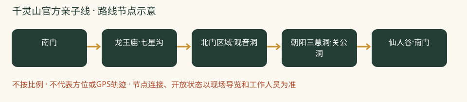

# 千灵山官方亲子线：一日攻略

> 有明确长度的山林石窟路线｜本轮排名 4｜资料整理：2026-10-26｜基准周末：10月31日至11月1日。8-9岁多孩小队，山林徒步优先。未实地踩线、未电话预订。

## 怎么选与评分

| 维度 | 0-5分 | 权重 | 换算得分 | 理由 |
|---|---:|---:|---:|---|
| 秋色 | 4.0 | 25 | 20.0 | 彩叶与石窟结合，红叶规模不作为唯一卖点 |
| 儿童适配 | 4.0 | 25 | 20.0 | 官方3.7公里线可用，停车接近路与台阶须计入 |
| 交通 | 3.0 | 15 | 9.0 | 多人队拼车更顺，公共接驳不确定 |
| 行程舒适 | 3.0 | 15 | 9.0 | 南门午饭可安排，沿途补给不能依赖 |
| 人流体验 | 3.5 | 10 | 7.0 | 比顶流赏叶点有弹性，但不保证人少 |
| 执行确定性 | 4.0 | 10 | 8.0 | 官方节点明确，累计爬升及本周封段尚待临期确认 |

**总分：73.0/100。** 主观规划分，不是景区评级；见[评分规则](README.md#评分规则)。

## 路线、景色与体力

官方亲子线约3.7公里，官方参考2-2.5小时；孩子队留3-3.5小时。停车场往返另计；累计爬升未公开，不以主峰海拔替代。

南门 → 龙王庙·七星沟 → 北门区域·观音洞 → 朝阳三慧洞·关公洞 → 仙人谷·南门。

这是官方亲子线节点，不加极乐峰、悬崖栈道与飞拉达。入口如告知中段关闭，改七星沟开放段原路返回。

**打卡点**

- 七星沟彩林与亭榭
- 允许开放的石窟外观
- 仙人谷沿线的山林层次，不钻暗洞

**今年时机：**丰台2026-10-18预报预计10月25日至11月5日较佳。3月官方线路只证明路线结构，不拿春花和水景宣传当秋日实况。

## 一天怎么安排

时间为组织建议，不是实测到达时间；每段按最慢孩子调整，取消后半段也算完成。

| 时间 | 安排 |
|---|---|
| 07:50 | 市区西部出发 |
| 09:10-09:40 | 停车接近、厕所，核亲子线与午饭 |
| 09:40-10:30 | 南门至龙王庙、七星沟慢走 |
| 10:30-10:45 | 加餐、全队体力检查 |
| 10:45-12:45 | 按开放官方亲子线完成石窟与仙人谷段，随时缩短 |
| 13:00-14:00 | 南门午饭、换衣休息 |
| 14:00-15:30 | 返程，不再去戒台寺补景点 |

## 自驾与停车

市区西部约60-90分钟预算，导航千灵山公园南门。停车楼至检票处可能还有接近路，09:00前到、另预留20-30分钟；不绕锥桶和围挡找入口。

## 公共交通

本轮未取得本周可靠班车及末段公交运行证明，多孩队默认拼车。不把旧文北门接驳用于南门集合。

## 午饭怎么解决

09:00到南门时先问亲子餐厅当日午餐、座位、菜单和末点时间；13:00返回后选面饭、蛋肉与蔬菜，不点过辣。餐厅存在来自2025旅游指南，未电话核营业，故每家必须自带能直接吃的午饭。中途10:30加餐，不空腹熬到13:00。

## 厕所、补水与休息

南门上厕所，入口询问亲子线路上的开放厕所。按山路无可靠热水、商店准备；不为了极乐洞热水偏离基本线。

## 门票、开放与预约

北京旅游网列成人参考45元、9月1日至11月15日7:30-16:30，15:00止票。儿童政策原文含混，须向园方010-83870645确认，走正规购票渠道。不要误买飞拉达体验票。

## 家庭预算

一大一小门票先留100元、午餐约60-120元，停车交通另计。预算不等于已确认儿童票。

## 缩短路线、天气与撤退

七星沟阶段疲倦就沿来路返回；不依赖索道救场。网上7-10公里登主峰环线与本方案不同，不能混用轨迹。

## 给孩子的任务

按官方路牌轮流当导航员，成人决定方向；观察石窟为何建在山中，只看开放区域。

## 资料、近期经验与未知项

两年原帖均读正文：停车接近路不能遗漏；今年主峰环线9.81公里、爬升592米、4小时21分，是作者记录，不套给官方3.7公里线。

- [2026官方3.7公里亲子线与节点](https://www.beijing.gov.cn/ywdt/gqrd/202603/t20260320_4562506.html)
- [景区票价、季节时段与电话](https://s.visitbeijing.com.cn/attraction/117974)
- [2025亲子设施参考（非本周营业保证）](https://www.visitbeijing.com.cn/article/4Mkfhb7cof0?device=amp)
- [2025-10-25，娜娜是佳佳：千灵山亲子小记](https://www.xiaohongshu.com/explore/68fcb9d700000000070373d7)
- [2026-10-25，Joker：千灵山9.81公里实走](https://www.xiaohongshu.com/explore/6adddeca0000000024038348)

小红书仅采用作者公开经验，里程与停车费未经独立实测；原帖可能要求登录。未复制全文或把旧照片当今年现场。图片原帖可点来源查看，未取得转载许可的不打包进仓库。

[返回总览与评分](README.md) · [天气与队伍准备](出行准备与安全.md)
