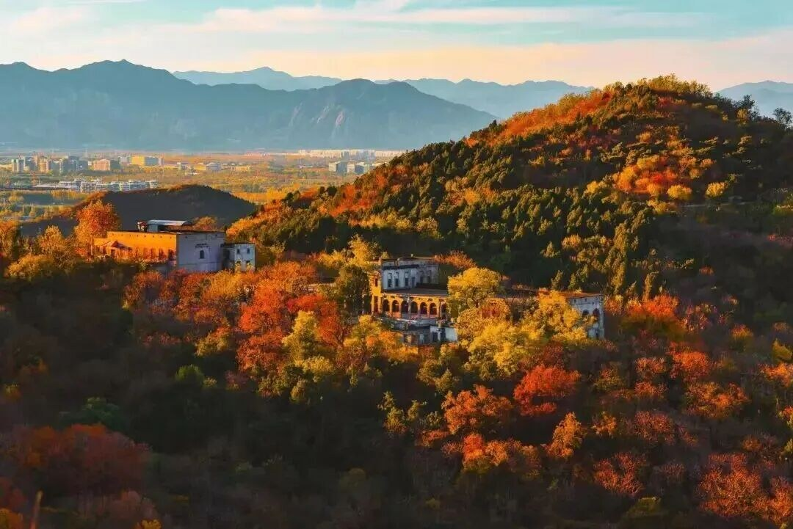
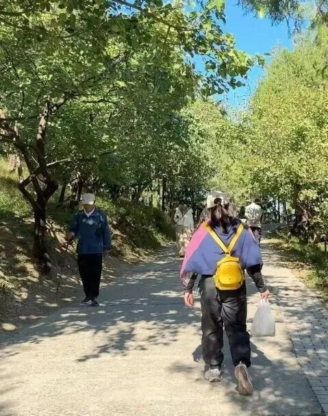
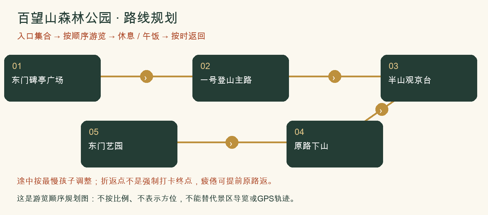

# 百望山森林公园：一日攻略

> 地铁方便＋轻登高＋城市远眺｜各城区最容易会合，第一次组队也好安排。｜排名1/8｜20261026-v3｜8-9岁孩子｜基准周末10月31日至11月1日。各城区出发，当天往返；未实地踩线或电话预订。

**特点：地铁方便＋轻登高＋城市远眺。各城区最容易会合，第一次组队也好安排。**

*百望山层次分明的山林与登高远景。2026-10-20发布，拍摄日期未标注；非实时叶色。[图片来源：北京旅游网综合](https://www.visitbeijing.com.cn/article/4TgYO5RfscG)。*

*百望山林间主路：一起慢走、观察彩叶。2026-10-20发布，拍摄日期未标注；非实时叶色。[图片来源：北京旅游网综合](https://www.visitbeijing.com.cn/article/4TgYO5RfscG)。*

## 评分

| 维度 | 0-5分 | 换算分 | 理由 |
|---|---:|---:|---|
| 秋色（25） | 3.5 | 17.5 | 彩叶丰富但当季原帖叶色判断不一，不承诺满山红 |
| 儿童适配（25） | 4.5 | 22.5 | 可只走东门至半山，不把20分钟登顶宣传当儿童用时 |
| 交通（15） | 4.5 | 13.5 | 16号线马连洼可达，适合各家地铁集合 |
| 行程舒适（15） | 4.5 | 13.5 | 东门与半山有当季驿站、市集，可先解决午饭 |
| 人流体验（10） | 3.5 | 7.0 | 周末有客流，东门集合仍比远山更好组织 |
| 执行确定性（10） | 4.5 | 9.0 | 当季官方节点与设施信息较完整，特定栈道开放仍须确认 |

**总分83.0/100。** [统一评分说明](README.md#评分与排序)。

## 从全市各处怎么会合

**集合：**09:45 东门集合；地铁家庭可09:15马连洼站A口会合。

**结束：**14:30-15:00。

各家庭从西城、海淀、朝阳等实际地址分别出发，在景区入口集合，不先绕到一个市区点。出门时刻=集合时刻-本家当日路线预计耗时-停车/步行20至30分钟。各方案的分钟数只是跨城排程宽预算，不是导航实测；不能把行政区当成一个固定起点。

各城区初步门到门排程预留：自驾60-120分钟；公共交通75-135分钟。这是为了约集合而留的宽缓冲，不是实时导航测算，也不表示每个区都要这么久。西城、海淀、朝阳各自以周五同一时段的导航预计耗时倒推，另加停车步行20-30分钟；远端家庭可能更久。

**自驾：**各家分别前往，不先绕到城里共同集合。导航百望山森林公园东门及正规停车场。不要按北门停车经验安排东门接人。 以景区检票入口为集合点，导航停车场后仍要留步行时间；按上方集合时刻倒推。

**公共交通：**建议16号线马连洼站集合，A口到东门约700-1000米，儿童步行留15-25分钟。各家庭先到站再共同走；出发前核对出入口临时管制。

**迟到：**出发前30分钟在家长群报预计抵达时刻；缓冲窗口内集合，超过窗口由领队决定全队等候还是安排成人陪迟到家庭在入口会合。不得让儿童独自在山路追队。

## 路线与景色

东门往返本次线路控制3-4公里，约2.5-3小时含休息；地铁站往返步行额外约1.4-2公里。海拔210米不是累计爬升。

东门碑亭广场 → 一号登山主路 → 半山观京台 → 原路下山 → 东门艺园。

全队体力好且导览确认路段开放，才从半山继续至佘太君庙方向再返；不默认拼接北门222/291环线。

**打卡点**

- 观京台：有城市背景的山林合影
- 主路彩叶：用落叶辨黄栌、元宝枫与银杏
- 东门碑亭与林间光影：适合队伍合照

**赏秋时机：**2026秋季市集至11月15日；2025官方报道说明多树种赏秋特点，不能照搬去年兑换活动。10月下旬近期原帖对红叶程度意见不同，按局部彩叶而非满山红安排。

## 一天怎么安排

各时间为组织建议，不是节点实测。吃饭、拍照、休息和停车接近均算进一天；能当天往返不等于必须把所有加量段走完。

| 时间 | 安排 |
|---|---|
| 09:30-10:00 | 各家分别到景区入口集合；停车、厕所、补水与点名 |
| 10:00-11:15 | 按方案正规路线开始山林步行、观景与打卡 |
| 11:15-11:30 | 温水和主食加餐；按最慢孩子调整后半段 |
| 11:30-12:30 | 继续基本线路并回到午饭点；不为赶路取消休息 |
| 12:30-13:30 | 午饭、厕所、换汗湿内层；若在山上则自带午饭 |
| 13:30-14:30 | 半山主路、午饭与下午自然观察；想增加运动可沿开放主路继续上行再原路返 |
| 14:30-15:00 | 在入口点名解散；各家按实际路程返城，不承诺统一到家时间 |

## 吃饭与备用午餐

12:30前回东门艺园，官方列披萨等简餐；半山观京台列热干面、牛肉饼，可作途中补能。先问座位、是否可做不辣，再点餐。每家自带主食作市集未开或排队备份；不为一摊饭额外爬山。

## 厕所、补水与休息

东门先上厕所并问清观京台最近开放厕所。驿站可休息，不能推断每站都有厕所或免费热水；自带温水。

## 门票、开放与预约

成人参考6元；通过‘北京市海淀百望山森林公园’官方公众号查看购票与儿童优惠，带儿童有效证件，不预设免费。当季官方列旺季6:00-18:00，静园20:00；按14:30-15:00结束安排。咨询010-62884356（历史公开电话，临期核实）。

## 家庭预算

一大一小门票先预留12元，餐食约60-120元，地铁另计；不是儿童票价认定。

## 缩短路线与撤退

半山观京台就是完整推荐线路终点；任何孩子疲倦即原路返。北门游客的‘两小时4公里’不等于本队实走承诺，陡阶291不作下山捷径。

## 给孩子的观察任务

给同一座山画三种观察图：叶片近景、树冠中景、观京台远景。比较为什么颜色看起来不同。

## 资料与仍待确认

北门原帖提供栈道和陡阶差别，因此本队采用官方东门主路而非照抄北门环线。2025使用林草局秋季报道，未取得匹配的2025小红书完整原帖。

- [2026官方市集、餐饮、驿站与开放时段](https://www.beijing.gov.cn/fuwu/bmfw/sy/jrts/202610/t20261012_4898421.html)
- [2025秋季四种游线与树种（国家林草局）](https://www.forestry.gov.cn/c/www/lcstly/647261.jhtml)
- [2026票价与马连洼接驳（北京号）](https://xinwen.bjd.com.cn/content/s69b2ad52d5dedd6a22eec94f.html?innerId=1)
- [2026-10-25，Catherine：北门4公里环线（小红书原帖）](https://www.xiaohongshu.com/explore/6adc63eb0000000024039af8)

旧照片、成人轨迹、官方稳定规则和本周开放分开看。停车费、门票优惠、餐馆营业、接驳均须临期核实。照片出处与时间见图下注及图片署名页；原帖可要求登录。

[返回方案总览](README.md) · [行前准备](出行准备与安全.md)
