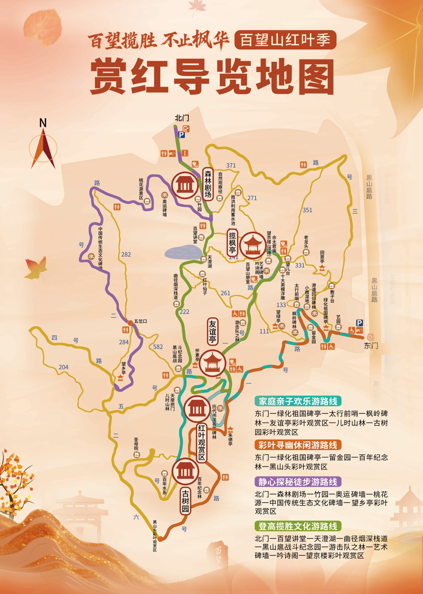
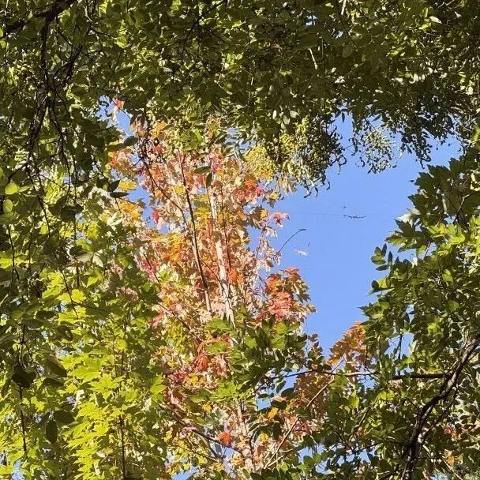
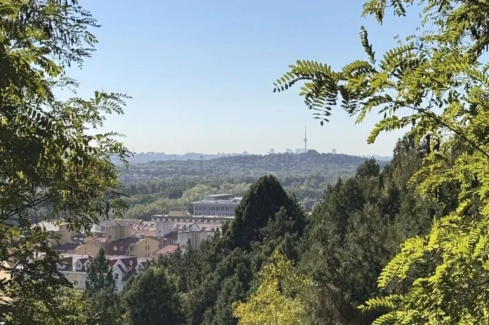
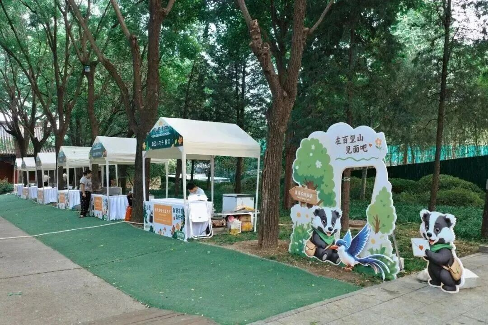

# 百望山森林公园｜一日攻略

> 排名 1/8 · 83.0/100 · 适合8-9岁 · 20261026-v4

**地铁方便＋亲子山路＋古树彩叶**

各城区容易会合，沿官方亲子游线看彩林与碑林。

2026文章资料图，拍摄日期未标注；非本周叶色保证。[北京旅游网综合](https://www.visitbeijing.com.cn/article/4TgYO5RfscG)。署名：北京旅游网综合；逐图署名见原文及素材说明。

## 先看是否适合这次组队

| 项目 | 本次安排 |
|---|---|
| 核心特点 | 地铁方便＋亲子山路＋古树彩叶。各城区容易会合，沿官方亲子游线看彩林与碑林。 |
| 适合谁 | 8-9岁小学生家庭，能随队走山路、按最慢孩子调整 |
| 步行与强度 | 采用2025官方导览图的青绿色家庭亲子线，沿已开放路段分段往返；当天步行控制约3-4公里，含观察休息约3小时。马连洼站到东门的往返接近步行另计。 |
| 集合 | 09:45 东门集合；地铁家庭可09:15马连洼站A口会合 |
| 结束 | 14:30-15:00 |
| 午饭 | 12:30；东门艺园简餐，自带午餐备份 |
| 成行前提 | 按景区当日开放游线执行 |

## 路线图与走法

**地图来源**：[北京旅游网官方综合稿刊载的公园赏红导览图](https://www.visitbeijing.com.cn/article/4Ow5LDVtrCe)；2025-10-29。

**本次怎么走**：沿原图青绿色家庭亲子游线：东门—绿化祖国碑亭—太行前哨—枫岭碑林—友谊亭—儿时山林、古树园，按时间原路折返。紫色北门游线和山顶长线不在本次计划内。

**游览顺序**：东门 → 绿化祖国碑亭 → 太行前哨·枫岭碑林 → 友谊亭 → 儿时山林·古树园 → 原路回东门艺园。

先在东门拍下当天导览牌，按家庭亲子线走至友谊亭、古树园一带后折返；不把北门长线或山顶路线拼入本次行程。

## 沿路最值得看的景色

- 枫岭碑林：彩叶与碑刻一起拍
- 友谊亭、古树园：从树形与落叶看山林层次
- 东门艺园：队伍合照、午饭与休息

### 百望山正规林间主路

2026文章资料图，拍摄日期未标注；非本周叶色保证。[北京旅游网综合](https://www.visitbeijing.com.cn/article/4TgYO5RfscG)。署名：北京旅游网综合；逐图署名见原文及素材说明。

### 百望山彩叶近景

2026文章资料图，拍摄日期未标注；非本周叶色保证。[北京旅游网综合](https://www.visitbeijing.com.cn/article/4TgYO5RfscG)。署名：北京旅游网综合；逐图署名见原文及素材说明。

### 百望山公园远眺城市景观

2026文章资料图，拍摄日期未标注；非本周叶色保证。[北京旅游网综合](https://www.visitbeijing.com.cn/article/4TgYO5RfscG)。署名：北京旅游网综合；逐图署名见原文及素材说明。

### 百望山秋季市集摊位

2026文章资料图，拍摄日期未标注；非本周叶色保证。[北京旅游网综合](https://www.visitbeijing.com.cn/article/4TgYO5RfscG)。署名：北京旅游网综合；逐图署名见原文及素材说明。

**赏秋时机**：2026秋季市集至11月15日；2025官方报道说明多树种赏秋特点，不能照搬去年兑换活动。10月下旬近期原帖对红叶程度意见不同，按局部彩叶而非满山红安排。

## 一天怎么安排

时间是儿童小队的组织安排，包含加餐、午饭、休息和拍照。现场按最慢孩子调整。

| 时间 | 地点与安排 |
|---|---|
| 09:15-09:45 | 地铁家庭在马连洼站A口会合后走到东门，自驾家庭直接到东门 |
| 09:45-10:00 | 东门点名、厕所与补水 |
| 10:00-11:10 | 经绿化祖国碑亭、太行前哨和枫岭碑林，边走边认彩叶 |
| 11:10-11:30 | 友谊亭附近休息、加餐 |
| 11:30-12:30 | 从所到位置沿来路回东门艺园，返程顺路观察，不为到古树园继续拓展 |
| 12:30-13:30 | 东门艺园午饭，排队超过15分钟则用自带午餐 |
| 13:30-14:30 | 东门艺园与碑林慢逛，画自然笔记，不再重复上山 |
| 14:30-15:00 | 东门点名解散，各家返城 |

## 交通与集合

**集合**：09:45 东门集合；地铁家庭可09:15马连洼站A口会合。

**结束**：14:30-15:00。

各家庭从西城、海淀、朝阳等实际地址分别出发，在约定的景区入口集合。先查本家当天导航，再倒推出门时刻；另留停车、进出站和步行20-30分钟。下列交通范围仅为排程宽预算，不是各行政区固定车程。

交通排程宽预算：自驾60-120分钟；公共交通75-135分钟。这是为了约集合而留的宽缓冲，不是实时导航测算，也不表示每个区都要这么久。西城、海淀、朝阳各自以周五同一时段的导航预计耗时倒推，另加停车步行20-30分钟；远端家庭可能更久。

**自驾**：导航百望山森林公园东门及正规停车场。不要按北门停车经验安排东门接人。

**公共交通**：建议16号线马连洼站集合，A口到东门约700-1000米，儿童步行留15-25分钟。各家庭先到站再共同走；出发前核对出入口临时管制。

[打开高德地图搜索集合区域](https://www.amap.com/search?query=%E7%99%BE%E6%9C%9B%E5%B1%B1%E6%A3%AE%E6%9E%97%E5%85%AC%E5%9B%AD%E4%B8%9C%E9%97%A8)。认准正文约定的入口，地名搜索结果不是精确轨迹。

## 午饭怎么解决

12:30回东门艺园吃午饭，公开活动资料列披萨等简餐；先确认座位和不辣主食，排队超过15分钟就使用自带主食。午后留在东门周边，不再上山找饭。

## 厕所、补水与休息

东门先上厕所并确认亲子线沿途当日开放的厕所。驿站可休息，温水自行带足。

## 门票与预算

成人参考6元；通过‘北京市海淀百望山森林公园’官方公众号查看购票与儿童优惠，带儿童有效证件，不预设免费。当季官方列旺季6:00-18:00，静园20:00；按14:30-15:00结束安排。咨询010-62884356（历史公开电话，临期核实）。

## 一家一小预算参考

一大一小门票先预留12元，餐食约60-120元，地铁另计；不是儿童票价认定。

## 折返与特别提醒

11:30从所到位置原路返回；孩子疲倦更早返。友谊亭和古树园是沿线参考点，不为集齐打卡延后下山。

## 给孩子的观察任务

画三种观察图：一片叶子的近景、一棵古树的树冠、碑林与山林的中景，比较同一座山的颜色与形状。

## 分项评分与理由

| 维度 | 0-5分 | 换算分 | 理由 |
|---|---:|---:|---|
| 秋色（权重25） | 3.5 | 17.5 | 彩叶丰富但当季原帖叶色判断不一，不承诺满山红 |
| 儿童适配（权重25） | 4.5 | 22.5 | 东门官方亲子线分段往返，地图节点清楚，按最慢孩子调整 |
| 交通（权重15） | 4.5 | 13.5 | 16号线马连洼可达，适合各家地铁集合 |
| 行程舒适（权重15） | 4.5 | 13.5 | 东门与半山有当季驿站、市集，可先解决午饭 |
| 人流体验（权重10） | 3.5 | 7.0 | 周末有客流，东门集合仍比远山更好组织 |
| 执行确定性（权重10） | 4.5 | 9.0 | 当季官方节点与设施信息较完整，特定栈道开放仍须确认 |

**总分**：83.0/100。[统一评分说明](README.md#评分与排序)。

## 资料依据

北门原帖提供栈道和陡阶差别，因此本队采用官方东门主路而非照抄北门环线。2025使用林草局秋季报道，未取得匹配的2025小红书完整原帖。

- [2025官方赏红导览图与家庭亲子线](https://www.visitbeijing.com.cn/article/4Ow5LDVtrCe)
- [2026官方市集、餐饮、驿站与开放时段](https://www.beijing.gov.cn/fuwu/bmfw/sy/jrts/202610/t20261012_4898421.html)
- [2025秋季四种游线与树种（国家林草局）](https://www.forestry.gov.cn/c/www/lcstly/647261.jhtml)
- [2026票价与马连洼接驳（北京号）](https://xinwen.bjd.com.cn/content/s69b2ad52d5dedd6a22eec94f.html?innerId=1)
- [2026-10-25，Catherine：北门4公里环线（小红书原帖）](https://www.xiaohongshu.com/explore/6adc63eb0000000024039af8)

照片只说明景观特点，历史图片不代表本周叶色。地图按来源标注，地区底图不是已验证的同线轨迹；当天开放、票务和公交以官方信息为准。共同装备与集合规则见[行前准备](出行准备与安全.md)。

[返回总览](README.md) · [图片与地图署名](assets/README.md)
