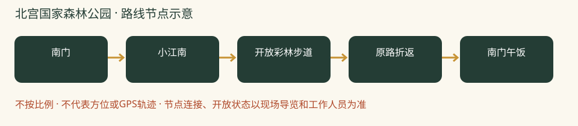

# 北宫国家森林公园：一日攻略

> 彩林＋湖景＋轻登山｜颜色丰富、景观变化多，适合一群孩子边爬边玩。｜排名2/8｜20261026-v2｜8-9岁孩子｜基准周末10月31日至11月1日。各城区出发，当天往返；未实地踩线或电话预订。

**特点：彩林＋湖景＋轻登山。颜色丰富、景观变化多，适合一群孩子边爬边玩。**

## 评分

| 维度 | 0-5分 | 换算分 | 理由 |
|---|---:|---:|---|
| 秋色（25） | 4.5 | 22.5 | 黄栌与多种彩叶，官方预报窗口覆盖目标周末；仍非全山通红 |
| 儿童适配（25） | 4.5 | 22.5 | 低位山林可随时折返，登狼坡顶只是自选加量 |
| 交通（15） | 3.0 | 9.0 | 各城区到西南山麓的通勤差异大，公交有末段接近路，按分散出发重新计分 |
| 行程舒适（15） | 4.5 | 13.5 | 山林、小江南与市集能安排动静交替 |
| 人流体验（10） | 3.5 | 7.0 | 热度上升，早到比相信‘免费人少’可靠 |
| 执行确定性（10） | 4.0 | 8.0 | 近期游客记录与当季官方活动吻合，停车和活动细节仍需临期核对 |

**总分82.5/100。** [统一评分说明](README.md#评分与排序)。

## 从全市各处怎么会合

**集合：**09:30-10:00 南门检票入口外集合；不是停车场入口。

**结束：**14:30-15:00。

各家庭从西城、海淀、朝阳等实际地址分别出发，在景区入口集合，不先绕到一个市区点。出门时刻=集合时刻-本家当日路线预计耗时-停车/步行20至30分钟。各方案的分钟数只是跨城排程宽预算，不是导航实测；不能把行政区当成一个固定起点。

各城区初步门到门排程预留：自驾90-150分钟；公共交通120-180分钟。这是为了约集合而留的宽缓冲，不是实时导航测算，也不表示每个区都要这么久。西城、海淀、朝阳各自以周五同一时段的导航预计耗时倒推，另加停车步行20-30分钟；远端家庭可能更久。

**自驾：**各家分别前往，不先绕到城里共同集合。导航‘北宫国家森林公园南门停车场（途经枫林路）’。仅停现场指挥的合法停车位；尽量提前到停车点，停车接近步行另留20分钟。近期游客报10元/次，仅参考现场牌价。 以景区检票入口为集合点，导航停车场后仍要留步行时间；按上方集合时刻倒推。

**公共交通：**地铁14号线张郭庄站A口换385路，或843路至北宫森林公园站，再步行约1公里到南门。这段步行要算进孩子全天体力，不因免票忽略接驳。公交实时班次出发前查。

**迟到：**出发前30分钟在家长群报预计抵达时刻；缓冲窗口内集合，超过窗口由领队决定全队等候还是安排成人陪迟到家庭在入口会合。不得让儿童独自在山路追队。

## 路线与景色

本次线路控制3-4公里，含休息约3小时；不是实测轨迹，停车接近路另计。狼坡顶只给全队有余力时加选，总步行控制5公里左右；未核累计爬升。

南门 → 小江南 → 开放彩林步道 → 原路折返 → 南门午饭。

狼坡顶不作为必达点；若选登顶，入园先向工作人员确认上下山连接与预计总长，不临场追随网上大环线。

**打卡点**

- 小江南：水面、桥与彩树同框
- 正规步道的黄栌林：逆光看圆形叶片
- 体力允许才加狼坡顶，登高看层次，不为纪念礼强登顶

**赏秋时机：**2026-10-18丰台官方预报预计10月26日至11月10日为较佳窗口；10月25日游客目测红叶约四至五成、黄栌较红。这是预报与个人观察，不能换算成周末保证。

## 一天怎么安排

各时间为组织建议，不是节点实测。吃饭、拍照、休息和停车接近均算进一天；能当天往返不等于必须把所有加量段走完。

| 时间 | 安排 |
|---|---|
| 09:30-10:00 | 各家分别到景区入口集合；停车、厕所、补水与点名 |
| 10:00-11:15 | 按方案正规路线开始山林步行、观景与打卡 |
| 11:15-11:30 | 温水和主食加餐；按最慢孩子调整后半段 |
| 11:30-12:30 | 继续基本线路并回到午饭点；不为赶路取消休息 |
| 12:30-13:30 | 午饭、厕所、换汗湿内层；若在山上则自带午饭 |
| 13:30-14:30 | 同园低位活动至14:30；体力够可加正规山路，不叠加另一景区 |
| 14:30-15:00 | 在入口点名解散；各家按实际路程返城，不承诺统一到家时间 |

## 吃饭与备用午餐

12:30左右回南门区域，先找有座位的市集主食，选择面、饼或饭加蛋白质，不把烤肠甜点当午餐。摊位供应和座位未保证，每个家庭带一份可直接食用主食；排队超过15分钟就启用自带午餐。在允许休息区用餐，不生火。

## 厕所、补水与休息

入园先问南门和小江南一带当日开放厕所、最后一处上山厕所；山上不依赖售货点。允许休息区可做落叶观察，动物区只观看，不投喂。

## 门票、开放与预约

北京旅游网景区页列免费、旺季6:30-19:00。是否需登记及临时封段以园方当天公告为准。咨询010-83840830；市集、体验和停车另计，不把入园免费理解为项目全免费。

## 家庭预算

一大一小自带饭约40-80元，现场简餐约80-150元；另加交通停车。为预算估算，不是套餐价。

## 缩短路线与撤退

任何孩子膝腿不适即沿已走过的正规步道返回南门。午后不新开山路；大风、降雨或步道湿滑则取消登山。

## 给孩子的观察任务

分组找三种叶形并画下来；比较同一棵树向阳与背阴叶色。只拍照、不摘叶，不跑下坡。

## 资料与仍待确认

采用近期实走的早到停车、黄栌已红而其他树未全红信息；不把游客目测百分比当气象监测。2025年以官方秋季资料对照，未取得匹配的2025小红书完整原帖。

- [2026北宫彩叶季、公交与停车入口（丰台区文旅局）](https://www.bjft.gov.cn/ftq/xwdt/jcdt/bmdt/202610/t20261016_227463.shtml)
- [门票、电话与开放时间（北京旅游网）](https://s.visitbeijing.com.cn/index.php/attraction/117723)
- [2025秋季对照：西山与北宫（市政府）](https://www.beijing.gov.cn/renwen/rwzyd/xltj/202510/t20251028_4241918.html)
- [2026-10-25，super汉堡妈：红叶与南门停车实况（小红书原帖）](https://www.xiaohongshu.com/explore/6ade015a0000000031039577)

旧照片、成人轨迹、官方稳定规则和本周开放分开看。停车费、门票优惠、餐馆营业、接驳均须临期核实。未授权原图不打包，原帖可要求登录。

[返回方案总览](README.md) · [行前准备](出行准备与安全.md)
