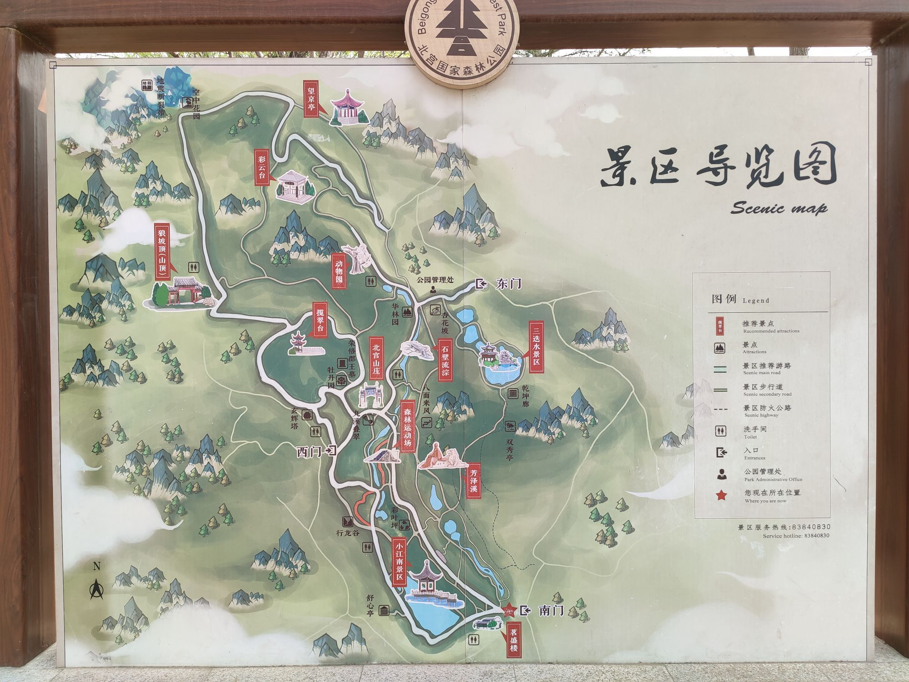
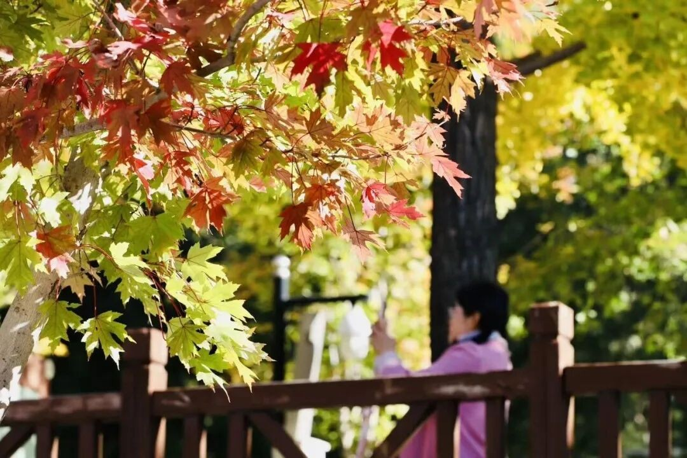
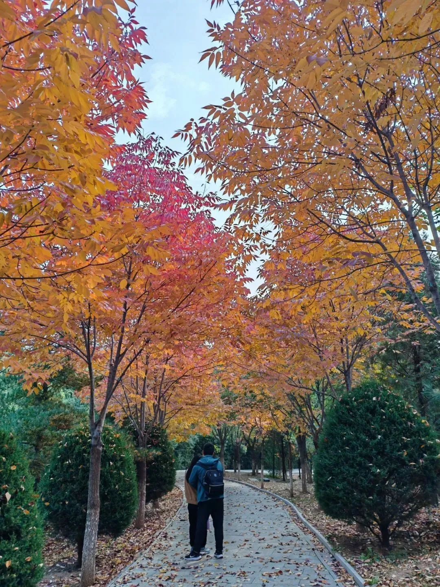
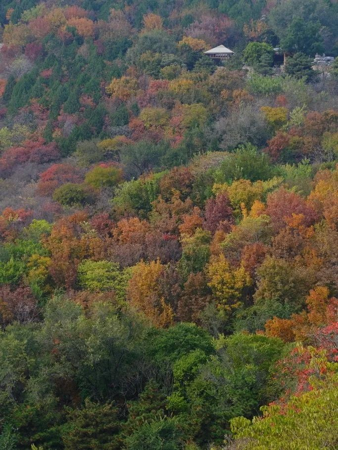

# 北宫国家森林公园｜一日攻略

> 排名 2/8 · 82.5/100 · 适合8-9岁 · 20261026-v4

**彩林＋湖景＋轻登山**

颜色丰富、景观变化多，适合一群孩子边爬边玩。

2024往年秋色资料，不代表今年实况。[北京旅游网综合](https://www.visitbeijing.com.cn/article/4KAXPmGpueo)。署名：北京旅游网综合；逐图署名见原文及素材说明。

## 先看是否适合这次组队

| 项目 | 本次安排 |
|---|---|
| 核心特点 | 彩林＋湖景＋轻登山。颜色丰富、景观变化多，适合一群孩子边爬边玩。 |
| 适合谁 | 8-9岁小学生家庭，能随队走山路、按最慢孩子调整 |
| 步行与强度 | 南门—小江南—行龙谷低位开放段往返，当天步行控制3-4公里，含休息约3小时；停车和公交接近步行另计。 |
| 集合 | 09:30-10:00 南门检票入口外集合；不是停车场入口 |
| 结束 | 14:30-15:00 |
| 午饭 | 12:30；南门区域简餐或自带午餐 |
| 成行前提 | 按景区当日开放游线执行 |

## 路线图与走法

**地图来源**：[携程景区游客实拍导览牌；不是官方网页原件](https://you.ctrip.com/sight/beijing1/63006.html)；拍摄日期未标，页面2026-10-26读取。

**本次怎么走**：从图下方南门进入，走小江南、行龙谷低位开放段后原路返；东门是另一个门。图上狼坡顶、彩云台和望京亭不在本次短线内。

**游览顺序**：南门 → 小江南 → 行龙谷低位开放段 → 原路折返 → 南门午饭。

本次只走南门、小江南与行龙谷一带的低位开放游线，不登狼坡顶；到场核对当天导览牌与步道开放。

## 沿路最值得看的景色

- 小江南：水面、桥与彩树同框
- 正规步道的黄栌林：逆光看圆形叶片
- 行龙谷低位步道：一起找彩叶和山林光影

### 北宫彩叶下的木栏与水景

2026文章资料图，拍摄日期未标注；非本周叶色保证。[北京旅游网综合](https://www.visitbeijing.com.cn/article/4TgYO5RfscG)。署名：北京旅游网综合；逐图署名见原文及素材说明。

### 北宫林间彩叶步行道

2024往年秋色资料，不代表今年实况。[北京旅游网综合](https://www.visitbeijing.com.cn/article/4KAXPmGpueo)。署名：北京旅游网综合；逐图署名见原文及素材说明。

### 北宫层次丰富的山坡彩林

2024往年秋色资料，不代表今年实况。[北京旅游网综合](https://www.visitbeijing.com.cn/article/4KAXPmGpueo)。署名：北京旅游网综合；逐图署名见原文及素材说明。

### 北宫湖畔木步道

2026文章资料图，拍摄日期未标注；非本周叶色保证。[北京旅游网综合](https://www.visitbeijing.com.cn/article/4TgYO5RfscG)。署名：北京旅游网综合；逐图署名见原文及素材说明。

**赏秋时机**：2026-10-18丰台官方预报预计10月26日至11月10日为较佳窗口；10月25日游客目测红叶约四至五成、黄栌较红。这是预报与个人观察，不能换算成周末保证。

## 一天怎么安排

时间是儿童小队的组织安排，包含加餐、午饭、休息和拍照。现场按最慢孩子调整。

| 时间 | 地点与安排 |
|---|---|
| 09:30-10:00 | 南门集合、厕所与补水 |
| 10:00-11:00 | 小江南看湖面倒影、过桥拍彩林 |
| 11:00-11:20 | 休息与加餐 |
| 11:20-12:30 | 沿行龙谷低位开放步道看彩叶，再原路回南门 |
| 12:30-13:30 | 南门区域吃午饭；市集排队久就使用自带主食 |
| 13:30-14:30 | 小江南周边慢走、叶片观察，不再登狼坡顶 |
| 14:30-15:00 | 南门点名解散，各家返城 |

## 交通与集合

**集合**：09:30-10:00 南门检票入口外集合；不是停车场入口。

**结束**：14:30-15:00。

各家庭从西城、海淀、朝阳等实际地址分别出发，在约定的景区入口集合。先查本家当天导航，再倒推出门时刻；另留停车、进出站和步行20-30分钟。下列交通范围仅为排程宽预算，不是各行政区固定车程。

交通排程宽预算：自驾90-150分钟；公共交通120-180分钟。这是为了约集合而留的宽缓冲，不是实时导航测算，也不表示每个区都要这么久。西城、海淀、朝阳各自以周五同一时段的导航预计耗时倒推，另加停车步行20-30分钟；远端家庭可能更久。

**自驾**：导航‘北宫国家森林公园南门停车场（途经枫林路）’。仅停现场指挥的合法停车位；尽量提前到停车点，停车接近步行另留20分钟。近期游客报10元/次，仅参考现场牌价。

**公共交通**：地铁14号线张郭庄站A口换385路，或843路至北宫森林公园站，再步行约1公里到南门。这段步行要算进孩子全天体力，不因免票忽略接驳。公交实时班次出发前查。

[打开高德地图搜索集合区域](https://www.amap.com/search?query=%E5%8C%97%E5%AE%AB%E5%9B%BD%E5%AE%B6%E6%A3%AE%E6%9E%97%E5%85%AC%E5%9B%AD%E5%8D%97%E9%97%A8)。认准正文约定的入口，地名搜索结果不是精确轨迹。

## 午饭怎么解决

12:30左右回南门区域，先找有座位的市集主食，选择面、饼或饭加蛋白质，不把烤肠甜点当午餐。摊位供应和座位未保证，每个家庭带一份可直接食用主食；排队超过15分钟就启用自带午餐。在允许休息区用餐，不生火。

## 厕所、补水与休息

入园先问南门和小江南一带当日开放厕所、最后一处上山厕所；山上不依赖售货点。允许休息区可做落叶观察，动物区只观看，不投喂。

## 门票与预算

北京旅游网景区页列免费、旺季6:30-19:00。是否需登记及临时封段以园方当天公告为准。咨询010-83840830；市集、体验和停车另计，不把入园免费理解为项目全免费。

## 一家一小预算参考

一大一小自带饭约40-80元，现场简餐约80-150元；另加交通停车。为预算估算，不是套餐价。

## 折返与特别提醒

任何孩子膝腿不适即沿已走过的正规步道返回南门。午后不新开山路；大风、降雨或步道湿滑则取消登山。

## 给孩子的观察任务

分组找三种叶形并画下来；比较同一棵树向阳与背阴叶色。只拍照、不摘叶，不跑下坡。

## 分项评分与理由

| 维度 | 0-5分 | 换算分 | 理由 |
|---|---:|---:|---|
| 秋色（权重25） | 4.5 | 22.5 | 黄栌与多种彩叶，官方预报窗口覆盖目标周末；仍非全山通红 |
| 儿童适配（权重25） | 4.5 | 22.5 | 南门低位山林分段往返，随时可折返，不以狼坡顶为目标 |
| 交通（权重15） | 3.0 | 9.0 | 各城区到西南山麓的通勤差异大，公交有末段接近路，按分散出发重新计分 |
| 行程舒适（权重15） | 4.5 | 13.5 | 山林、小江南与市集能安排动静交替 |
| 人流体验（权重10） | 3.5 | 7.0 | 热度上升，早到比相信‘免费人少’可靠 |
| 执行确定性（权重10） | 4.0 | 8.0 | 近期游客记录与当季官方活动吻合，停车和活动细节仍需临期核对 |

**总分**：82.5/100。[统一评分说明](README.md#评分与排序)。

## 资料依据

采用近期实走的早到停车、黄栌已红而其他树未全红信息；不把游客目测百分比当气象监测。2025年以官方秋季资料对照，未取得匹配的2025小红书完整原帖。

- [2026北宫彩叶季、公交与停车入口（丰台区文旅局）](https://www.bjft.gov.cn/ftq/xwdt/jcdt/bmdt/202610/t20261016_227463.shtml)
- [门票、电话与开放时间（北京旅游网）](https://s.visitbeijing.com.cn/index.php/attraction/117723)
- [2025秋季对照：西山与北宫（市政府）](https://www.beijing.gov.cn/renwen/rwzyd/xltj/202510/t20251028_4241918.html)
- [2026-10-25，super汉堡妈：红叶与南门停车实况（小红书原帖）](https://www.xiaohongshu.com/explore/6ade015a0000000031039577)

照片只说明景观特点，历史图片不代表本周叶色。地图按来源标注，地区底图不是已验证的同线轨迹；当天开放、票务和公交以官方信息为准。共同装备与集合规则见[行前准备](出行准备与安全.md)。

[返回总览](README.md) · [图片与地图署名](assets/README.md)
