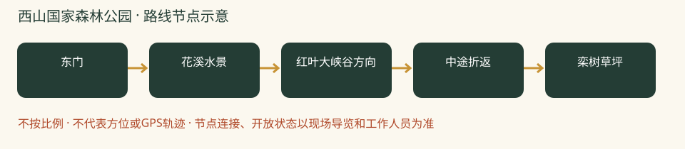

# 西山国家森林公园：一日攻略

> 红叶山林＋近城徒步｜想把重点放在看红叶、走山林，选这一条。｜排名3/8｜20261026-v2｜8-9岁孩子｜基准周末10月31日至11月1日。各城区出发，当天往返；未实地踩线或电话预订。

**特点：红叶山林＋近城徒步。想把重点放在看红叶、走山林，选这一条。**

## 评分

| 维度 | 0-5分 | 换算分 | 理由 |
|---|---:|---:|---|
| 秋色（25） | 4.5 | 22.5 | 红叶主题与黄栌山林突出，仍要等局部转色 |
| 儿童适配（25） | 4.0 | 20.0 | 裁剪低位往返适合小队，完整鬼笑石线强度不同 |
| 交通（15） | 3.5 | 10.5 | 全市分散出发可当天往返，东南部家庭跨城与末段接驳更久 |
| 行程舒适（15） | 3.5 | 10.5 | 低位有活动，但餐食座位近期反馈不佳 |
| 人流体验（10） | 3.0 | 6.0 | 红叶季热门，不采用人少承诺 |
| 执行确定性（10） | 4.5 | 9.0 | 2026活动与2025景观资料齐全，短线长度是控制目标 |

**总分78.5/100。** [统一评分说明](README.md#评分与排序)。

## 从全市各处怎么会合

**集合：**09:30-10:00 东门检票入口外集合。

**结束：**14:30-15:00。

各家庭从西城、海淀、朝阳等实际地址分别出发，在景区入口集合，不先绕到一个市区点。出门时刻=集合时刻-本家当日路线预计耗时-停车/步行20至30分钟。各方案的分钟数只是跨城排程宽预算，不是导航实测；不能把行政区当成一个固定起点。

各城区初步门到门排程预留：自驾90-150分钟；公共交通105-165分钟。这是为了约集合而留的宽缓冲，不是实时导航测算，也不表示每个区都要这么久。西城、海淀、朝阳各自以周五同一时段的导航预计耗时倒推，另加停车步行20-30分钟；远端家庭可能更久。

**自驾：**各家分别前往，不先绕到城里共同集合。定位‘北京西山国家森林公园东门停车场’，不要与百望山或香山混淆。建议尽量提前到停车点；停满服从正规分流，不照抄路边停车攻略。 以景区检票入口为集合点，导航停车场后仍要留步行时间；按上方集合时刻倒推。

**公共交通：**以东门为导航终点组合地铁与末段公交/网约车；本轮未核到可靠的当日公交班次，不写成地铁直达。各家约定同一东门集合，返程车辆不要约在山路上。

**迟到：**出发前30分钟在家长群报预计抵达时刻；缓冲窗口内集合，超过窗口由领队决定全队等候还是安排成人陪迟到家庭在入口会合。不得让儿童独自在山路追队。

## 路线与景色

控制3-4公里、约3小时含观察休息；到哪折返由现场路牌、时间与最慢孩子决定，不声称这是已测量闭环。

东门 → 花溪水景 → 红叶大峡谷方向 → 中途折返 → 栾树草坪。

入口问清通往红叶大峡谷的正规路线，最多走至全队可轻松返回的位置；半山亭、鬼笑石不作为推荐线路必达点。宣传亲子全线也含鬼笑石，不照单全收。

**打卡点**

- 花溪水景周边树影
- 红叶大峡谷方向的黄栌和彩林近景
- 栾树草坪周边国风、市集与林景，避开拥挤表演区

**赏秋时机：**2026红叶文化节10月15日至11月15日。10月25日一年级家长反馈尚未大面积转红，预计后续更好；只是个人判断，不保证目标周末达到盛红。

## 一天怎么安排

各时间为组织建议，不是节点实测。吃饭、拍照、休息和停车接近均算进一天；能当天往返不等于必须把所有加量段走完。

| 时间 | 安排 |
|---|---|
| 09:30-10:00 | 各家分别到景区入口集合；停车、厕所、补水与点名 |
| 10:00-11:15 | 按方案正规路线开始山林步行、观景与打卡 |
| 11:15-11:30 | 温水和主食加餐；按最慢孩子调整后半段 |
| 11:30-12:30 | 继续基本线路并回到午饭点；不为赶路取消休息 |
| 12:30-13:30 | 午饭、厕所、换汗湿内层；若在山上则自带午饭 |
| 13:30-14:30 | 午后低位林间慢走；不为填满时间强登鬼笑石 |
| 14:30-15:00 | 在入口点名解散；各家按实际路程返城，不承诺统一到家时间 |

## 吃饭与备用午餐

主方案自带足量可直接吃的午餐，在允许休息区域用餐；市集仅作加餐或现场确认有座位、有主食后替换。近期家长反馈价格高、缺桌凳，所以不把一杯饮料加烤肠当午饭。午后不靠饿着下山找饭。

## 厕所、补水与休息

东门上厕所，入口问沿线最近厕所；不假定峡谷途中有补给。草坪不是天然允许野餐或球类的许可，按现场分区使用。

## 门票、开放与预约

‘北京西山国家森林公园’官方公众号查询门票、儿童优惠和临时通知。公开资料常见成人10元，本轮未完成当期票务价核准，按购票页为准。旺季7:00-18:00，静园21:00不作为儿童离园时刻。

## 家庭预算

一大一小门票预算先留20元、自带午餐约40-80元；停车交通另计。

## 缩短路线与撤退

不爬鬼笑石、不走香巴拉穿越，不跟夜景团。半程已疲倦就原路返回；湿叶打滑或大风改为取消山路。

## 给孩子的观察任务

黄栌叶与枫叶形状一样吗？用同一片自然落叶分别背光、迎光拍照，比较色彩。

## 资料与仍待确认

真正吸收近期停车排队、市集少座位与尚未盛红反馈。搜索2025关键词仍主要返回今年帖子，没有把搜索词里的2025当发布日期。

- [2026西山红叶节（国家林草局）](https://www.forestry.gov.cn/lyj/1/lcstly/20261016/692656.html)
- [2026游线与季节时段（北京旅游网）](https://www.visitbeijing.com.cn/article/4TgYO5RfscG)
- [2025秋季景观与路线对照（市政府）](https://www.beijing.gov.cn/renwen/rwzyd/xltj/202510/t20251028_4241918.html)
- [2026-10-25，常小花1992：一年级亲子停车与餐饮（小红书原帖）](https://www.xiaohongshu.com/explore/6add7891000000002c0110a1)

旧照片、成人轨迹、官方稳定规则和本周开放分开看。停车费、门票优惠、餐馆营业、接驳均须临期核实。未授权原图不打包，原帖可要求登录。

[返回方案总览](README.md) · [行前准备](出行准备与安全.md)
