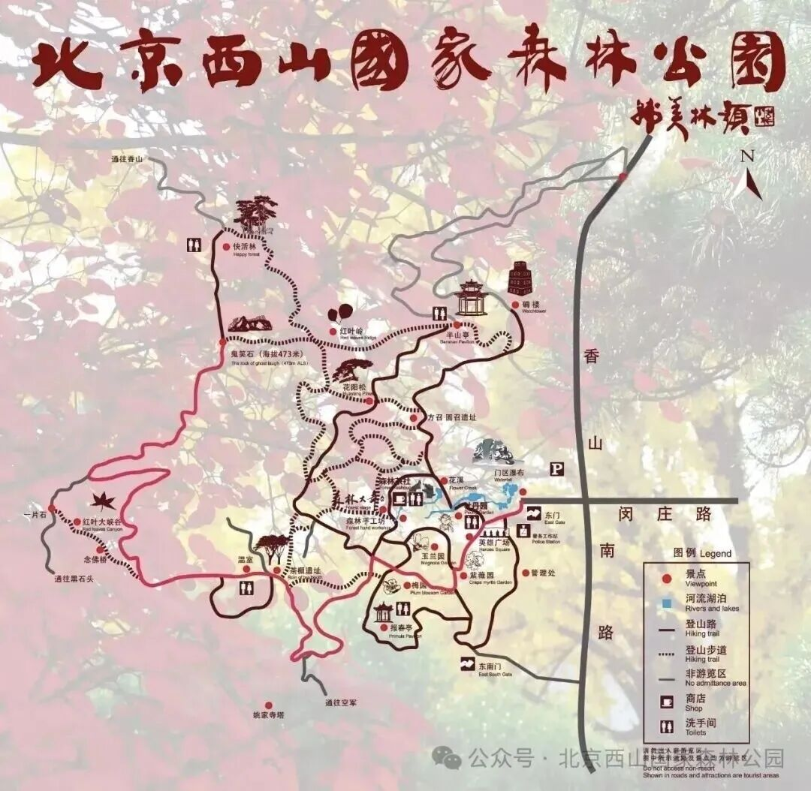
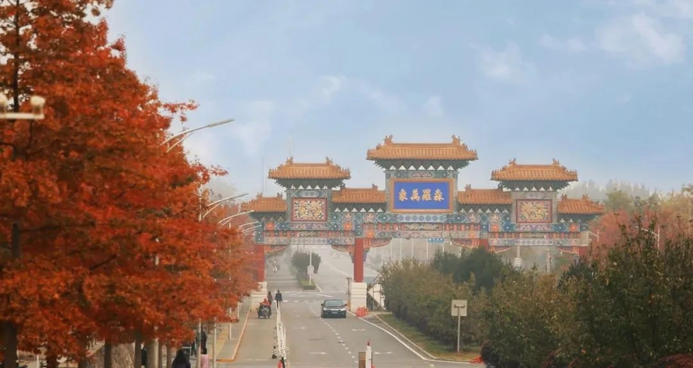
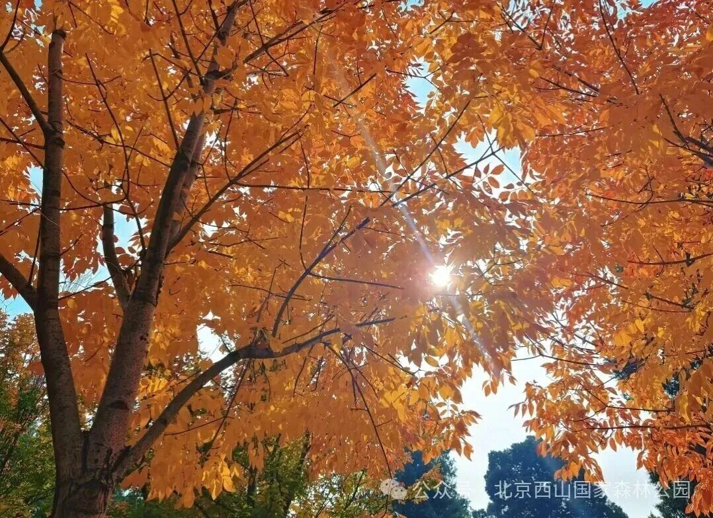
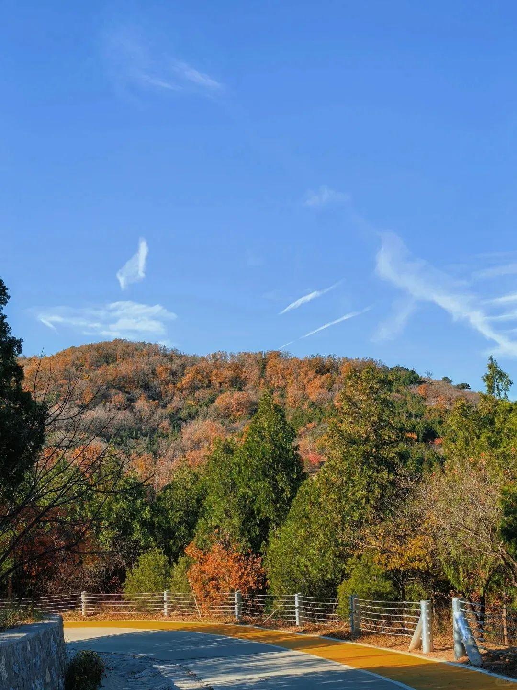

# 西山国家森林公园｜一日攻略

> 排名 3/8 · 78.5/100 · 适合8-9岁 · 20261026-v4

**红叶山林＋近城徒步**

想把重点放在看红叶、走山林，选这一条。

2026文章资料图，拍摄日期未标注；非本周叶色保证。[北京旅游网综合](https://www.visitbeijing.com.cn/article/4TgYO5RfscG)。署名：北京旅游网综合；逐图署名见原文及素材说明。

## 先看是否适合这次组队

| 项目 | 本次安排 |
|---|---|
| 核心特点 | 红叶山林＋近城徒步。想把重点放在看红叶、走山林，选这一条。 |
| 适合谁 | 8-9岁小学生家庭，能随队走山路、按最慢孩子调整 |
| 步行与强度 | 控制3-4公里、约3小时含观察休息；到哪折返由现场路牌、时间与最慢孩子决定，不声称这是已测量闭环。 |
| 集合 | 09:30-10:00 东门检票入口外集合 |
| 结束 | 14:30-15:00 |
| 午饭 | 12:20；自带午餐为主 |
| 成行前提 | 按景区当日开放游线执行 |

## 路线图与走法

**地图来源**：[北京旅游网官方综合稿/公园导览图](https://www.visitbeijing.com.cn/article/4TgYO5RfscG)；2026-10-20。

**本次怎么走**：只走图下部东门—门区瀑布—花溪—森林大舞台—东茶棚方向的低位部分，按时折返。原图粉色完整线路含鬼笑石；本次不走完整红线。

**游览顺序**：东门 → 门区瀑布·花溪 → 森林大舞台 → 东茶棚方向折返 → 回东门。

采用官方地图中东门、花溪、森林大舞台至东茶棚方向的低位部分，按时间原路返；不把地图红线上的鬼笑石完整环线当本次短线。

## 沿路最值得看的景色

- 门区瀑布与花溪：山林、水景同框
- 森林大舞台至东茶棚方向：低位彩林和林间步道
- 红叶近景：背光看黄栌叶脉，不为取景跨护栏

### 西山国家森林公园东门外观

2024往年秋色资料，不代表今年实况。[北京旅游网综合](https://www.visitbeijing.com.cn/article/4KAXPmGpueo)。署名：北京旅游网综合；逐图署名见原文及素材说明。

### 西山逆光秋叶与林间光影

2026文章资料图，拍摄日期未标注；非本周叶色保证。[北京旅游网综合](https://www.visitbeijing.com.cn/article/4TgYO5RfscG)。署名：北京旅游网综合；逐图署名见原文及素材说明。

### 西山彩林旁的正规游览道路

2024往年秋色资料，不代表今年实况。[北京旅游网综合](https://www.visitbeijing.com.cn/article/4KAXPmGpueo)。署名：北京旅游网综合；逐图署名见原文及素材说明。

**赏秋时机**：2026红叶文化节10月15日至11月15日。10月25日一年级家长反馈尚未大面积转红，预计后续更好；只是个人判断，不保证目标周末达到盛红。

## 一天怎么安排

时间是儿童小队的组织安排，包含加餐、午饭、休息和拍照。现场按最慢孩子调整。

| 时间 | 地点与安排 |
|---|---|
| 09:30-10:00 | 东门集合、厕所与补水 |
| 10:00-11:00 | 门区瀑布、花溪，沿开放游路走向森林大舞台 |
| 11:00-11:20 | 平整休息处加餐与拍照 |
| 11:20-12:20 | 沿既有游路向东茶棚方向观察彩林；12:00前停止向远处拓展 |
| 12:20-13:10 | 允许休息区吃自带午餐 |
| 13:10-14:30 | 原路返回，留足花溪与低位彩叶观察时间 |
| 14:30-15:00 | 东门点名解散，各家返城 |

## 交通与集合

**集合**：09:30-10:00 东门检票入口外集合。

**结束**：14:30-15:00。

各家庭从西城、海淀、朝阳等实际地址分别出发，在约定的景区入口集合。先查本家当天导航，再倒推出门时刻；另留停车、进出站和步行20-30分钟。下列交通范围仅为排程宽预算，不是各行政区固定车程。

交通排程宽预算：自驾90-150分钟；公共交通105-165分钟。这是为了约集合而留的宽缓冲，不是实时导航测算，也不表示每个区都要这么久。西城、海淀、朝阳各自以周五同一时段的导航预计耗时倒推，另加停车步行20-30分钟；远端家庭可能更久。

**自驾**：定位‘北京西山国家森林公园东门停车场’，不要与百望山或香山混淆。建议尽量提前到停车点；停满服从正规分流，不照抄路边停车攻略。

**公共交通**：以东门为导航终点组合地铁与末段公交/网约车；本轮未核到可靠的当日公交班次，不写成地铁直达。各家约定同一东门集合，返程车辆不要约在山路上。

[打开高德地图搜索集合区域](https://www.amap.com/search?query=%E5%8C%97%E4%BA%AC%E8%A5%BF%E5%B1%B1%E5%9B%BD%E5%AE%B6%E6%A3%AE%E6%9E%97%E5%85%AC%E5%9B%AD%E4%B8%9C%E9%97%A8)。认准正文约定的入口，地名搜索结果不是精确轨迹。

## 午饭怎么解决

12:20-13:10在允许休息区吃自带午餐。市集只作加餐；公开游客反馈座位有限，不依赖临场全队找桌位。

## 厕所、补水与休息

东门上厕所，入口问沿线最近厕所；不假定峡谷途中有补给。草坪不是天然允许野餐或球类的许可，按现场分区使用。

## 门票与预算

‘北京西山国家森林公园’官方公众号查询门票、儿童优惠和临时通知。公开资料常见成人10元，本轮未完成当期票务价核准，按购票页为准。旺季7:00-18:00，静园21:00不作为儿童离园时刻。

## 一家一小预算参考

一大一小门票预算先留20元、自带午餐约40-80元；停车交通另计。

## 折返与特别提醒

不爬鬼笑石、不走香巴拉穿越，不跟夜景团。半程已疲倦就原路返回；湿叶打滑或大风改为取消山路。

## 给孩子的观察任务

黄栌叶与枫叶形状一样吗？用同一片自然落叶分别背光、迎光拍照，比较色彩。

## 分项评分与理由

| 维度 | 0-5分 | 换算分 | 理由 |
|---|---:|---:|---|
| 秋色（权重25） | 4.5 | 22.5 | 红叶主题与黄栌山林突出，仍要等局部转色 |
| 儿童适配（权重25） | 4.0 | 20.0 | 裁剪低位往返适合小队，完整鬼笑石线强度不同 |
| 交通（权重15） | 3.5 | 10.5 | 全市分散出发可当天往返，东南部家庭跨城与末段接驳更久 |
| 行程舒适（权重15） | 3.5 | 10.5 | 低位有活动，但餐食座位近期反馈不佳 |
| 人流体验（权重10） | 3.0 | 6.0 | 红叶季热门，不采用人少承诺 |
| 执行确定性（权重10） | 4.5 | 9.0 | 2026活动与2025景观资料齐全，短线长度是控制目标 |

**总分**：78.5/100。[统一评分说明](README.md#评分与排序)。

## 资料依据

真正吸收近期停车排队、市集少座位与尚未盛红反馈。搜索2025关键词仍主要返回今年帖子，没有把搜索词里的2025当发布日期。

- [2026西山红叶节（国家林草局）](https://www.forestry.gov.cn/lyj/1/lcstly/20261016/692656.html)
- [2026游线与季节时段（北京旅游网）](https://www.visitbeijing.com.cn/article/4TgYO5RfscG)
- [2025秋季景观与路线对照（市政府）](https://www.beijing.gov.cn/renwen/rwzyd/xltj/202510/t20251028_4241918.html)
- [2026-10-25，常小花1992：一年级亲子停车与餐饮（小红书原帖）](https://www.xiaohongshu.com/explore/6add7891000000002c0110a1)

照片只说明景观特点，历史图片不代表本周叶色。地图按来源标注，地区底图不是已验证的同线轨迹；当天开放、票务和公交以官方信息为准。共同装备与集合规则见[行前准备](出行准备与安全.md)。

[返回总览](README.md) · [图片与地图署名](assets/README.md)
