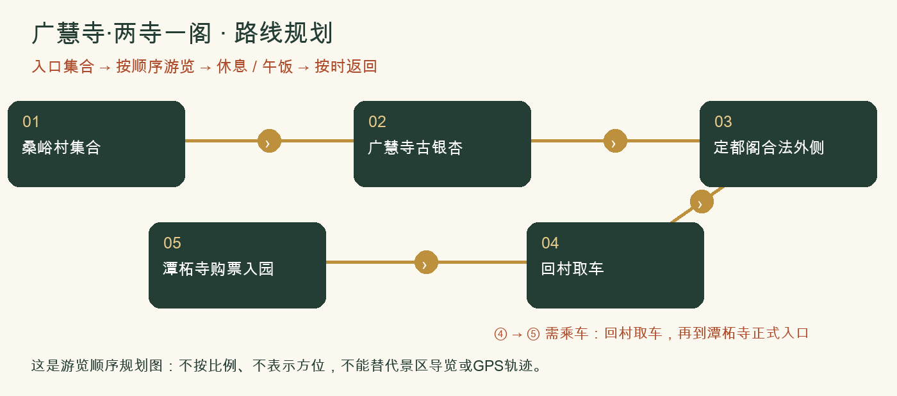

# 广慧寺·两寺一阁：一日攻略

> 古道＋两寺银杏＋定都阁远眺｜一整天把山林与古建串起来，最接近你认可的徒步思路。｜排名4/8｜20261026-v3｜8-9岁孩子｜基准周末10月31日至11月1日。各城区出发，当天往返；未实地踩线或电话预订。

**特点：古道＋两寺银杏＋定都阁远眺。一整天把山林与古建串起来，最接近你认可的徒步思路。**

*广慧寺院落古银杏。2026-10-18发布，拍摄日期未标注；非实时叶色。[图片来源：北京旅游网综合](https://www.visitbeijing.com.cn/article/4TeunGHpU29)。*

*下午潭柘寺：银杏与古建飞檐。2025-11-05发布的往年秋色资料；非今年实况。[图片来源：北京旅游网](https://www.visitbeijing.com.cn/article/4P0SilHTGYk)。*

## 评分

| 维度 | 0-5分 | 换算分 | 理由 |
|---|---:|---:|---|
| 秋色（25） | 4.5 | 22.5 | 古银杏、秋林与古寺组合突出，去年叶色不当今年实况 |
| 儿童适配（25） | 4.0 | 20.0 | 用户认可约7公里300米强度；不同环线可达500米，必须选同一条路线 |
| 交通（15） | 3.0 | 9.0 | 各城区自驾可当天返，公共交通需安排两端接驳 |
| 行程舒适（15） | 3.0 | 9.0 | 途中厕所与补给有限，以自带午饭为主 |
| 人流体验（10） | 4.0 | 8.0 | 非单一热门寺院，能边走边观察；热点仍需避让 |
| 执行确定性（10） | 3.5 | 7.0 | 去年原帖与今年实走有交叉，但不能把两条轨迹拼成核准线 |

**总分75.5/100。** [统一评分说明](README.md#评分与排序)。

## 从全市各处怎么会合

**集合：**09:00 桑峪村观山小筑附近事先确认的合法步道入口。

**结束：**15:45-16:00 潭柘寺正式出口。

各家庭从西城、海淀、朝阳等实际地址分别出发，在景区入口集合，不先绕到一个市区点。出门时刻=集合时刻-本家当日路线预计耗时-停车/步行20至30分钟。各方案的分钟数只是跨城排程宽预算，不是导航实测；不能把行政区当成一个固定起点。

各城区初步排程预留：自驾100-180分钟；地铁加末段接驳约150-240分钟。是宽缓冲预算、不是实测导航；各家以实际地址核时间，另留停车与步行20-30分钟。长线当天需较早出发。

**自驾：**分别导航门头沟潭柘寺镇桑峪村观山小筑附近，提前向熟路朋友确认合法停车点和村内通行。2025原帖的免费停车不是2026车位与收费保证。若停车须服从外场分流，就把步行算进全天总量。

**公共交通：**可按地铁6号线金安桥方向再接合法网约车或当地公交安排当天往返，但原帖“金安桥打车15分钟”未核实，不采用固定用时。周五查去返接驳；回程事先约好村内可达上车点。若只接受纯公共交通、末班衔接未查到，则不默认安排这条长线。

**迟到：**出发前30分钟在家长群报预计抵达时刻；缓冲窗口内集合，超过窗口由领队决定全队等候还是安排成人陪迟到家庭在入口会合。不得让儿童独自在山路追队。

## 路线与景色

参考用户认可的2025路线约7公里、爬升300米；孩子队山林徒步预留4.5-5小时含休息和路餐，寺内参观另留约1小时。2026另有同名7公里500米版本，出发前须让熟路成人确认采用的同一条轨迹；不将两条路线拼接。

桑峪村集合 → 广慧寺古银杏 → 定都阁合法外侧 → 回村取车 → 潭柘寺购票入园。

推荐一天一条山林线加一次寺院参观：桑峪村出发，走确认通行的古道经广慧寺、定都阁合法外侧后回村，再乘车到潭柘寺正式入口购票参观。徒步和寺院内步行要合并计算，不从后山翻入寺内，不爬巨石。进度落后就直接回村返程，不赶双寺。

**打卡点**

- 广慧寺古银杏与山门：先看当年新实拍决定追黄叶时机
- 定都阁合法外侧可视区域：不进入修缮区，不爬凌云巨石
- 古道秋林、亭与村落远景；潭柘寺院内帝王树仅在合法购票进入后看

**赏秋时机：**分享帖由sky于2025-11-16编辑，标题记录11月14日：当时广慧寺叶已落，潭柘寺配王树仍有叶。它适合判断去年错峰物候，不证明今年10月底叶色。2026官方10月18日仍推荐广慧寺古银杏与万桑古道；2026近期原帖照片为发布前一周。

## 一天怎么安排

各时间为组织建议，不是节点实测。吃饭、拍照、休息和停车接近均算进一天；能当天往返不等于必须把所有加量段走完。

| 时间 | 安排 |
|---|---|
| 09:00-09:15 | 桑峪村入口集合，厕所、点名、核同一轨迹 |
| 09:15-10:30 | 古道至广慧寺，看古银杏与古建 |
| 10:30-10:45 | 温水、加餐与休息 |
| 10:45-12:00 | 定都阁合法外侧方向远眺，封闭区域不进入 |
| 12:00-12:35 | 允许区域自带午餐 |
| 12:35-13:45 | 沿确认的合法路线回桑峪村，不走天坑与围挡支线 |
| 13:45-14:30 | 休息、取车，转往潭柘寺正规停车场；时长为排程缓冲，非实测车程 |
| 14:30-15:45 | 正式购票入寺，看古银杏与院落 |
| 15:45-16:00 | 出口点名解散，各家分别返城 |

## 吃饭与备用午餐

主方案山上自带午饭：米饭团/三明治/饼、熟蛋或肉、少量水果与温水，每人分装，不点火。12:00-12:35在允许的平整休息处吃；13:45左右回村后转往潭柘寺，热饭可在全程结束后安排。林荫小院咖啡只作休息候选，未核主食座位；如要热饭，提前确认村内餐馆营业、不辣主食与多人座位。

## 厕所、补水与休息

村内集合先解决厕所、温水；官方旧线路说明山路无补给与厕所，按全程自给准备。寺院是否开放厕所不能当保证。备纸巾、垃圾袋、备用衣物、离线地图和头灯。

## 门票、开放与预约

广慧寺旧原帖称免费，不承诺今年规则。潭柘寺若另进，成人参考50元、儿童票按正式入口核准；定都阁近期游客报修缮，不购买或承诺入阁。区文旅局取消AAA不是闭园令，但也不是开放证明。

## 家庭预算

一大一小自带午饭40-80元；如进潭柘寺门票先留100元；交通、停车与可选热饭另计。无预订、无支付。

## 缩短路线与撤退

11:30仍不能确认回村进度或有孩子疲倦，就原路返回并取消后续寺院参观。回村转场前核剩余时间、票务与营业；16:00前结束山路，不等日落下山。任何封闭段不绕行；公交家庭先落实村内与寺门两段接驳。

## 给孩子的观察任务

比较两寺银杏物候与叶形，画古道石阶、读正规路牌；不摸果肉、不食银杏果，不攀古树。对树龄有不同考证，统一称古银杏。

## 资料与仍待确认

已直接读取用户分享的sky原帖（2025-11-16编辑，11月14日行程）。采用两寺一阁全天思路，修正：不照抄成人3.5小时、15分钟打车、免费停车、巨石拍照或寺院绕入。2026另帖7公里500米仅用于提醒同名路线不同，不与原帖平均。

- [用户分享：sky，2025-11-16编辑的两寺一阁原帖](https://www.xiaohongshu.com/explore/69192d0f0000000007021a68)
- [2026-10-18官方旅游推荐广慧寺与万桑古道](https://www.visitbeijing.com.cn/article/4TeunGHpU29)
- [2026近期万桑段7公里500米原帖](https://www.xiaohongshu.com/explore/6adb6887000000002a0124a1)
- [2023官方旅游游记8公里400米，设施参考](https://www.visitbeijing.com.cn/article/4C8m2DiLUuQ)
- [定都阁取消AAA公告](https://www.bjmtg.gov.cn/bjmtg/zwxx/zwgg/202609/d530bf90933445d2b5fda12dcd6b40e8.shtml)
- [北京10月日落时间](https://www.timeanddate.com/sun/china/beijing?month=10&year=2026)

旧照片、成人轨迹、官方稳定规则和本周开放分开看。停车费、门票优惠、餐馆营业、接驳均须临期核实。照片出处与时间见图下注及图片署名页；原帖可要求登录。

[返回方案总览](README.md) · [行前准备](出行准备与安全.md)
