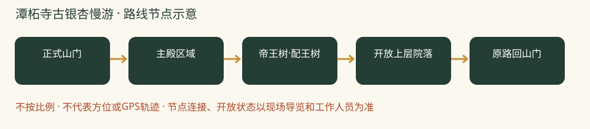

# 潭柘寺古银杏慢游：一日攻略

> 银杏专项，运动量较少的备选｜本轮排名 7｜资料整理：2026-10-26｜基准周末：10月31日至11月1日。8-9岁多孩小队，山林徒步优先。未实地踩线、未电话预订。

## 怎么选与评分

| 维度 | 0-5分 | 权重 | 换算得分 | 理由 |
|---|---:|---:|---:|---|
| 秋色 | 4.0 | 25 | 20.0 | 古树与古建观赏价值高，但10月25日仅向阳侧开始黄 |
| 儿童适配 | 3.0 | 25 | 15.0 | 台阶慢游易控制，本次按登山兴趣评分所以降权 |
| 交通 | 2.5 | 15 | 7.5 | 较远且银杏季停车容易排队 |
| 行程舒适 | 4.0 | 15 | 12.0 | 寺院慢游可充分休息，午饭有备份安排 |
| 人流体验 | 2.5 | 10 | 5.0 | 核心古树处客流集中，不承诺空镜 |
| 执行确定性 | 4.0 | 10 | 8.0 | 官方当季状态清楚，餐馆营业与儿童票仍须核准 |

**总分：67.5/100。** 主观规划分，不是景区评级；见[评分规则](README.md#评分规则)。

## 路线、景色与体力

寺内控制2-3公里、2.5-3小时，循正规参观路慢慢上阶。它是山地寺院慢游，不包装成爬山环线。

正式山门 → 主殿区域 → 帝王树·配王树 → 开放上层院落 → 原路回山门。

不从后山翻进寺，不接广慧寺环穿、定都阁、孔雀庵与天坑。一日只游一寺，午后增加观察和休息而非补另一山头。

**打卡点**

- 帝王树、配王树与古建屋檐
- 红墙与扇形银杏叶近景
- 开放院落的高低台阶与秋山背景，不保证能上某一楼阁

**今年时机：**2026银杏节10月24日启幕，10月25日官方报道向阳侧开始黄，未全黄；建议目标周末临期再看实拍，纯追金黄可考虑11月上旬，但不保证具体哪天。

## 一天怎么安排

时间为组织建议，不是实测到达时间；每段按最慢孩子调整，取消后半段也算完成。

| 时间 | 安排 |
|---|---|
| 07:50 | 市区西部出发 |
| 09:15-09:45 | 停车与入寺，厕所和当天参观路线 |
| 09:45-11:00 | 主殿、古银杏与建筑观察 |
| 11:00-12:00 | 正规开放院落慢走与休息，不硬凑台阶 |
| 12:00-13:00 | 门口素餐或自带午饭 |
| 13:00-14:00 | 在允许休息区整理手帐；出园后不默认可二次入寺 |
| 14:00-15:45 | 返程，拥堵另计 |

## 自驾与停车

市区西部约70-100分钟预算，导航潭柘寺景区正规停车场，银杏季另留30分钟排队。入口不与桑峪村古道起点混用。

## 公共交通

旧官方指引为苹果园换931路，当前接驳与发车间隔需北京公交临期核对。多孩团默认拼车，不把旧文班次当保证。

## 午饭怎么解决

12:00选寺门口正规素餐馆，点清汤面或炸酱另放的面食，先确认不辣与座位。近期原帖提到门口素餐馆但未写可靠店名，不伪造指定店。嘉福宾舍素食餐厅仅作待电话确认候选；备自带主食，不把寺内加福咖啡当午餐。

## 厕所、补水与休息

入寺先问厕所位置；热门树下不久坐挡路。银杏果不捡食，皮肤敏感孩子不触摸果肉。仅在允许区域观察自然落叶。

## 门票、开放与预约

北京旅游网参考成人50元、8:30-16:30。儿童优惠本轮未完整核准，带证件并在景区正式购票入口核实。010-60862505/60861699；活动演出时间另看当日公告。

## 家庭预算

一大一小门票先留100元、午餐60-120元，交通停车另计；未按未知儿童政策计算优惠。

## 缩短路线、天气与撤退

树叶未黄也不改走未知后山；台阶湿滑只在低位开放院落慢游。若唯一目标是登山运动，改选前四项。

## 给孩子的任务

比较两株古树叶色差异，记录向阳背阴。画一扇叶片，寻找二叉分枝的叶脉，不给树龄争议编造精确答案。

照片：N509FZ，2025-11-09，CC BY-SA 4.0；历史实拍，不是本周实况，不把门口银杏当帝王树定位图。完整来源见[图片署名](assets/README.md)。

## 资料、近期经验与未知项

采用近期素餐可询问清淡主食的经验，不把未写店名的面馆伪造成可预订店。2025图片来自官方编辑引用小红书作者，未冒充直接读过该作者原帖。

- [2026-10-25门头沟官方发布：开始变黄](https://xinwen.bjd.com.cn/content/s6addcdedd5def922be1bbbd4.html?innerId=1)
- [景区票价与公开电话](https://s.visitbeijing.com.cn/attraction/117841)
- [2025-11-05银杏实况含11月2日图片来源](https://www.visitbeijing.com.cn/article/4P0SilHTGYk)
- [2026-10-21，黄金颜如：门口素面与叶色反馈](https://www.xiaohongshu.com/explore/6ad75e6a000000002f030e30)

小红书仅采用作者公开经验，里程与停车费未经独立实测；原帖可能要求登录。未复制全文或把旧照片当今年现场。图片原帖可点来源查看，未取得转载许可的不打包进仓库。

**广慧寺能不能一起走？** 本轮补读两步路、Beijing Hikers及近期小红书后，仍不把整条环穿接在寺内游览后；[广慧寺专项](09-广慧寺短线研究.md)区分了短往返与7-8公里环线，并说明古树树龄争议。

[返回总览与评分](README.md) · [天气与队伍准备](出行准备与安全.md)
