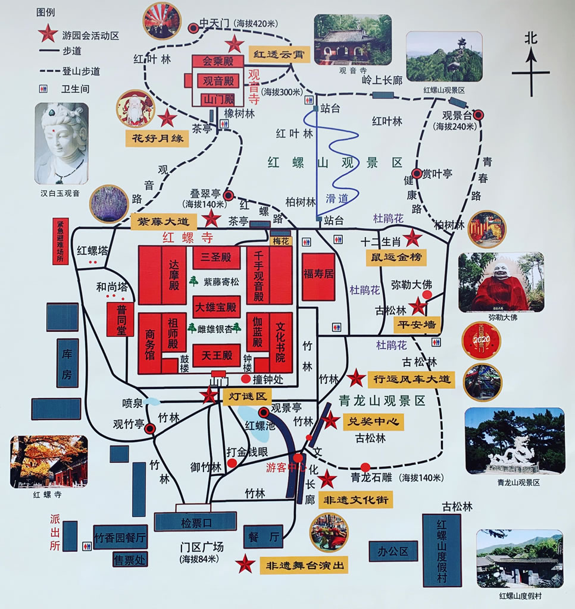
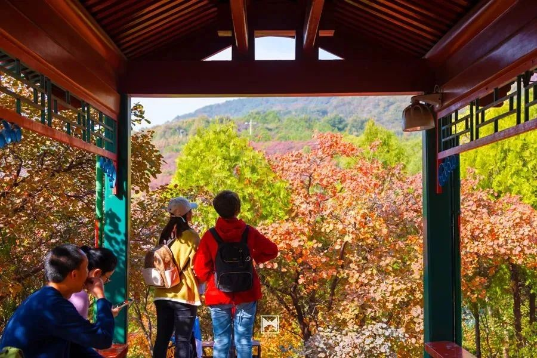
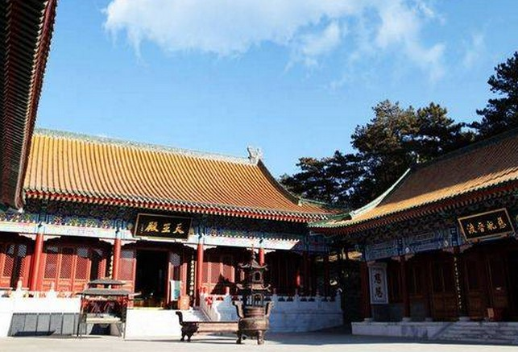

# 红螺寺古银杏与山林｜一日攻略

> 排名 5/8 · 69.5/100 · 适合8-9岁 · 20261026-v4

**古银杏＋竹林＋寺后山林**

一处兼看古树和爬山，景色丰富但车程较长。

2025往年秋色资料，不代表今年实况。[北京旅游网](https://www.visitbeijing.com.cn/article/4P0SilHTGYk)。署名：北京旅游网；逐图署名见原文及素材说明。

## 先看是否适合这次组队

| 项目 | 本次安排 |
|---|---|
| 核心特点 | 古银杏＋竹林＋寺后山林。一处兼看古树和爬山，景色丰富但车程较长。 |
| 适合谁 | 8-9岁小学生家庭，能随队走山路、按最慢孩子调整 |
| 步行与强度 | 本次线路控制3-4公里、3-3.5小时含休息；只在主寺区后方正规山路短走。完整观音路有大量台阶，不把成人1.6万步游记当儿童本次线路。 |
| 集合 | 09:30-10:00 红螺寺正式入口外集合 |
| 结束 | 15:00-15:30 |
| 午饭 | 12:30；自带午餐为主 |
| 成行前提 | 按景区当日开放游线执行 |

## 路线图与走法

**地图来源**：[景区导览图公开转载（365135）](https://www.365135.com/beijing/hongluosi.shtml)；历史导览图，拍摄日期未标，2026-10-26读取。

**本次怎么走**：检票口—御竹林—大雄宝殿前雌雄银杏—寺后叠翠亭方向短上坡，再沿来路返回。图上观音寺、中天门和高处红螺山不是必达目标。

**游览顺序**：门区·检票口 → 御竹林 → 大雄宝殿·雌雄银杏 → 叠翠亭方向短往返 → 原路回门区。

只把叠翠亭方向的短上坡作为山林部分，到场确认开放后往返；不登中天门，不以观音寺为必达，不依赖滑道下山。

## 沿路最值得看的景色

- 大雄宝殿前雌雄古银杏与屋檐
- 御竹林的绿色与秋叶形成对比
- 正规山路开阔休息点看远山，不站崖缘拍照

### 红螺寺御竹林与题石

景区长期资料图，非本周叶色。[北京旅游网红螺寺景区页](https://s.visitbeijing.com.cn/attraction/101418)。署名：北京旅游网红螺寺景区页；逐图署名见原文及素材说明。

### 红螺寺亭廊向外看山林彩叶

2022往年秋色资料，不代表今年实况。[北京旅游网综合](https://www.visitbeijing.com.cn/article/4A8vCcHfbRs)。署名：北京旅游网综合；逐图署名见原文及素材说明。

### 红螺寺银杏与大雄宝殿

2025往年秋色资料，不代表今年实况。[北京旅游网](https://www.visitbeijing.com.cn/article/4P0SilHTGYk)。署名：北京旅游网；逐图署名见原文及素材说明。

### 红螺寺大雄宝殿院落资料照

景区长期资料图，非本周叶色。[北京旅游网红螺寺景区页](https://s.visitbeijing.com.cn/attraction/101418)。署名：北京旅游网红螺寺景区页；逐图署名见原文及素材说明。

**赏秋时机**：2025-11-05官方旅游文章记录古银杏当时已到观赏期，仅作往年窗口参考。2026近期检索标题同时有‘预告’与‘最佳’，没有足够证据保证本周全黄，出发前看园方新实拍。

## 一天怎么安排

时间是儿童小队的组织安排，包含加餐、午饭、休息和拍照。现场按最慢孩子调整。

| 时间 | 地点与安排 |
|---|---|
| 09:30-10:00 | 正式入口集合、厕所与补水 |
| 10:00-11:00 | 御竹林、主寺区和大雄宝殿前雌雄银杏 |
| 11:00-11:20 | 加餐、休息与合照 |
| 11:20-12:20 | 从主寺区后侧向叠翠亭方向短上坡后原路回，按孩子状态提前折返 |
| 12:30-13:30 | 允许休息处吃自带午饭 |
| 13:30-14:30 | 主寺区、紫藤寄松与林下慢游，不重复上山 |
| 14:30-15:00 | 慢走回门区、厕所与整理装备 |
| 15:00-15:30 | 入口点名解散，各家返城 |

## 交通与集合

**集合**：09:30-10:00 红螺寺正式入口外集合。

**结束**：15:00-15:30。

各家庭从西城、海淀、朝阳等实际地址分别出发，在约定的景区入口集合。先查本家当天导航，再倒推出门时刻；另留停车、进出站和步行20-30分钟。下列交通范围仅为排程宽预算，不是各行政区固定车程。

交通排程宽预算：自驾110-180分钟；公共交通150-240分钟。这是为了约集合而留的宽缓冲，不是实时导航测算，也不表示每个区都要这么久。西城、海淀、朝阳各自以周五同一时段的导航预计耗时倒推，另加停车步行20-30分钟；远端家庭可能更久。

**自驾**：导航红螺寺景区正规停车场，各家按集合时刻倒推出门时间。午后返城另留堵车缓冲。

**公共交通**：常规公交需东直门916快接怀柔当地公交，耗时较长，可当天往返但耗时更长。通游专线节假日运行公告不等于普通周末一定开行，先在北京公交核班次。

[打开高德地图搜索集合区域](https://www.amap.com/search?query=%E7%BA%A2%E8%9E%BA%E5%AF%BA)。认准正文约定的入口，地名搜索结果不是精确轨迹。

## 午饭怎么解决

主方案自带午饭，12:30在允许休息处用餐；希望吃热饭则出发前联系景区入口正规餐馆，确认儿童不辣主食、多人座位和停车。未落实不临场全队找网红虹鳟店，更不加雁栖湖第二场。

## 厕所、补水与休息

入园与上山前先上厕所。山路不依赖摊位供热水；自带温水、纸巾、备用衣物。寺院安静慢行，不把祈福项目当儿童必做任务。

## 门票与预算

北京旅游网参考成人54元、全日制大中小学生有效学生证半价。儿童免票条件为6岁及以下或不足1.2米，8-9岁不能仅按儿童称呼认定免费。010-60681175/60681639，园方官方入口核准门票与季节闭园。

## 一家一小预算参考

若学生半价资格核准，一大一小门票约81元；餐食60-120元，加高速、油费与停车。

## 折返与特别提醒

主寺区赏树即是有效完成；有人疲倦全队取消山路。不能用成人20分钟陡阶下山数据催孩子。

## 给孩子的观察任务

银杏与竹子叶形有什么不同？看古树保护围栏与支撑设施，讨论怎样保护一棵老树。禁止食用银杏果。

## 分项评分与理由

| 维度 | 0-5分 | 换算分 | 理由 |
|---|---:|---:|---|
| 秋色（权重25） | 4.5 | 22.5 | 古银杏、寺院与山林组合鲜明，今年全黄程度未核准 |
| 儿童适配（权重25） | 3.5 | 17.5 | 可拆成寺院和短上坡，不走完整观音寺登顶 |
| 交通（权重15） | 2.0 | 6.0 | 北部或东北家庭可能更近，西南家庭更远；公交可当天返但时间长 |
| 行程舒适（权重15） | 3.5 | 10.5 | 午饭和山路分段安排，餐馆须提前确认 |
| 人流体验（权重10） | 3.0 | 6.0 | 银杏热点集中，清早参观更舒适 |
| 执行确定性（权重10） | 3.5 | 7.0 | 正规景区可用，最新叶色情况及短线爬升尚有缺口 |

**总分**：69.5/100。[统一评分说明](README.md#评分与排序)。

## 资料依据

近期原帖显示完整观音路、中天门行程有大量台阶和长步行，故主动裁剪。未把周中少人、成人快速下山或祈愿效果作为推荐依据。

- [门票与学生优惠（北京旅游网）](https://s.visitbeijing.com.cn/attraction/101418)
- [官方票务介绍与公开电话](https://english.beijing.gov.cn/specials/ticketing/attractions/202409/t20240930_3910069.html)
- [2025银杏观赏实况对照](https://www.visitbeijing.com.cn/article/4P0SilHTGYk)
- [2026-10-22编辑，爱拍照的鱼：1.6万步登山游记](https://www.xiaohongshu.com/explore/6ad87c6f000000003101f912)

照片只说明景观特点，历史图片不代表本周叶色。地图按来源标注，地区底图不是已验证的同线轨迹；当天开放、票务和公交以官方信息为准。共同装备与集合规则见[行前准备](出行准备与安全.md)。

[返回总览](README.md) · [图片与地图署名](assets/README.md)
