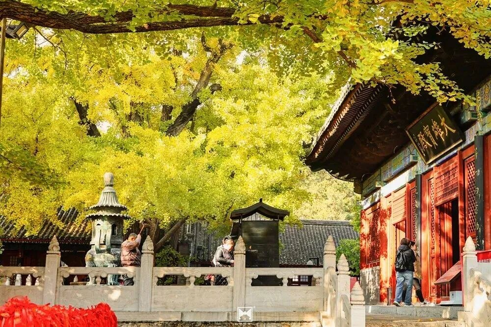
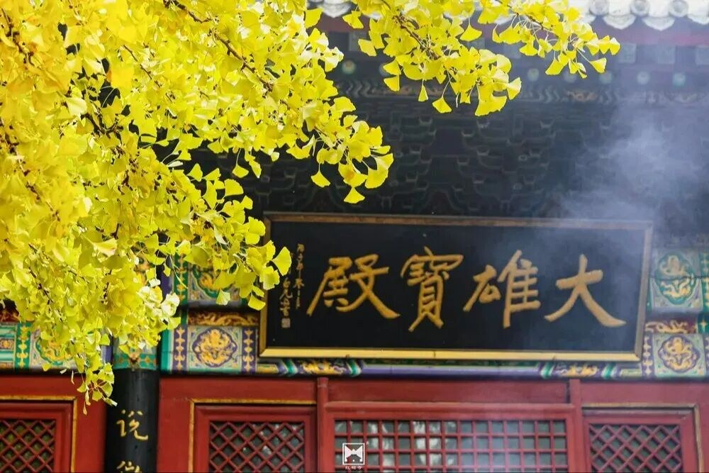
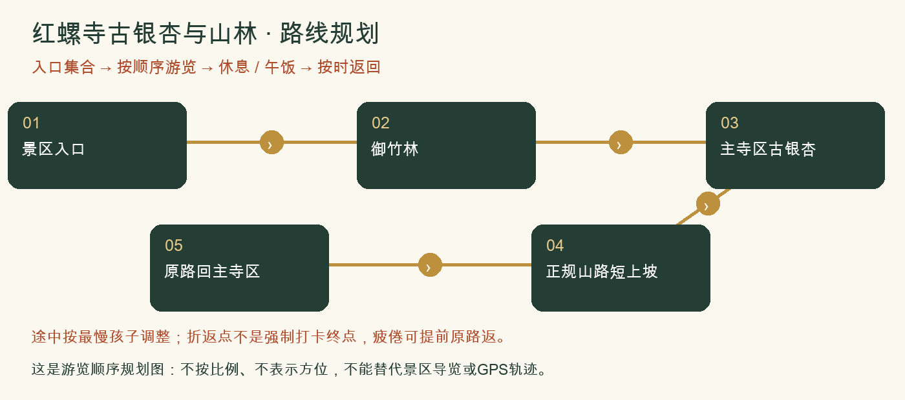

# 红螺寺古银杏与山林：一日攻略

> 古银杏＋竹林＋寺后山林｜一处兼看古树和爬山，景色丰富但车程较长。｜排名5/8｜20261026-v3｜8-9岁孩子｜基准周末10月31日至11月1日。各城区出发，当天往返；未实地踩线或电话预订。

**特点：古银杏＋竹林＋寺后山林。一处兼看古树和爬山，景色丰富但车程较长。**

*红螺寺金黄银杏与古刹院落。2025-11-05发布的往年秋色资料；非今年实况。[图片来源：北京旅游网](https://www.visitbeijing.com.cn/article/4P0SilHTGYk)。*

*红螺寺银杏与大雄宝殿同框。2025-11-05发布的往年秋色资料；非今年实况。[图片来源：北京旅游网](https://www.visitbeijing.com.cn/article/4P0SilHTGYk)。*

## 评分

| 维度 | 0-5分 | 换算分 | 理由 |
|---|---:|---:|---|
| 秋色（25） | 4.5 | 22.5 | 古银杏、寺院与山林组合鲜明，今年全黄程度未核准 |
| 儿童适配（25） | 3.5 | 17.5 | 可拆成寺院和短上坡，不走完整观音寺登顶 |
| 交通（15） | 2.0 | 6.0 | 北部或东北家庭可能更近，西南家庭更远；公交可当天返但时间长 |
| 行程舒适（15） | 3.5 | 10.5 | 午饭和山路分段安排，餐馆须提前确认 |
| 人流体验（10） | 3.0 | 6.0 | 银杏热点集中，清早参观更舒适 |
| 执行确定性（10） | 3.5 | 7.0 | 正规景区可用，最新叶色情况及短线爬升尚有缺口 |

**总分69.5/100。** [统一评分说明](README.md#评分与排序)。

## 从全市各处怎么会合

**集合：**09:30-10:00 红螺寺正式入口外集合。

**结束：**15:00-15:30。

各家庭从西城、海淀、朝阳等实际地址分别出发，在景区入口集合，不先绕到一个市区点。出门时刻=集合时刻-本家当日路线预计耗时-停车/步行20至30分钟。各方案的分钟数只是跨城排程宽预算，不是导航实测；不能把行政区当成一个固定起点。

各城区初步门到门排程预留：自驾110-180分钟；公共交通150-240分钟。这是为了约集合而留的宽缓冲，不是实时导航测算，也不表示每个区都要这么久。西城、海淀、朝阳各自以周五同一时段的导航预计耗时倒推，另加停车步行20-30分钟；远端家庭可能更久。

**自驾：**各家分别前往，不先绕到城里共同集合。导航红螺寺景区正规停车场，各家按集合时刻倒推出门时间。午后返城另留堵车缓冲。 以景区检票入口为集合点，导航停车场后仍要留步行时间；按上方集合时刻倒推。

**公共交通：**常规公交需东直门916快接怀柔当地公交，耗时较长，可当天往返但耗时更长。通游专线节假日运行公告不等于普通周末一定开行，先在北京公交核班次。

**迟到：**出发前30分钟在家长群报预计抵达时刻；缓冲窗口内集合，超过窗口由领队决定全队等候还是安排成人陪迟到家庭在入口会合。不得让儿童独自在山路追队。

## 路线与景色

本次线路控制3-4公里、3-3.5小时含休息；只在主寺区后方正规山路短走。完整观音路有大量台阶，不把成人1.6万步游记当儿童本次线路。

景区入口 → 御竹林 → 主寺区古银杏 → 正规山路短上坡 → 原路回主寺区。

入口确认合法山路和折返点，上坡最多约40分钟再回，短线不保证到观音寺；不登中天门、不追主峰，不靠滑道作撤退。

**打卡点**

- 大雄宝殿前雌雄古银杏与屋檐
- 御竹林的绿色与秋叶形成对比
- 正规山路开阔休息点看远山，不站崖缘拍照

**赏秋时机：**2025-11-05官方旅游文章记录古银杏当时已到观赏期，仅作往年窗口参考。2026近期检索标题同时有‘预告’与‘最佳’，没有足够证据保证本周全黄，出发前看园方新实拍。

## 一天怎么安排

各时间为组织建议，不是节点实测。吃饭、拍照、休息和停车接近均算进一天；能当天往返不等于必须把所有加量段走完。

| 时间 | 安排 |
|---|---|
| 09:30-10:00 | 各家分别到景区入口集合；停车、厕所、补水与点名 |
| 10:00-11:15 | 按方案正规路线开始山林步行、观景与打卡 |
| 11:15-11:30 | 温水和主食加餐；按最慢孩子调整后半段 |
| 11:30-12:30 | 继续基本线路并回到午饭点；不为赶路取消休息 |
| 12:30-13:30 | 午饭、厕所、换汗湿内层；若在山上则自带午饭 |
| 13:30-14:30 | 下午继续主寺区、林间观察或正规短山路；不将中天门设为必达 |
| 15:00-15:30 | 在入口点名解散；各家按实际路程返城，不承诺统一到家时间 |

## 吃饭与备用午餐

主方案自带午饭，12:30在允许休息处用餐；希望吃热饭则出发前联系景区入口正规餐馆，确认儿童不辣主食、多人座位和停车。未落实不临场全队找网红虹鳟店，更不加雁栖湖第二场。

## 厕所、补水与休息

入园与上山前先上厕所。山路不依赖摊位供热水；自带温水、纸巾、备用衣物。寺院安静慢行，不把祈福项目当儿童必做任务。

## 门票、开放与预约

北京旅游网参考成人54元、全日制大中小学生有效学生证半价。儿童免票条件为6岁及以下或不足1.2米，8-9岁不能仅按儿童称呼认定免费。010-60681175/60681639，园方官方入口核准门票与季节闭园。

## 家庭预算

若学生半价资格核准，一大一小门票约81元；餐食60-120元，加高速、油费与停车。

## 缩短路线与撤退

主寺区赏树即是有效完成；有人疲倦全队取消山路。不能用成人20分钟陡阶下山数据催孩子。

## 给孩子的观察任务

银杏与竹子叶形有什么不同？看古树保护围栏与支撑设施，讨论怎样保护一棵老树。禁止食用银杏果。

## 资料与仍待确认

近期原帖显示完整观音路、中天门行程有大量台阶和长步行，故主动裁剪。未把周中少人、成人快速下山或祈愿效果作为推荐依据。

- [门票与学生优惠（北京旅游网）](https://s.visitbeijing.com.cn/attraction/101418)
- [官方票务介绍与公开电话](https://english.beijing.gov.cn/specials/ticketing/attractions/202409/t20240930_3910069.html)
- [2025银杏观赏实况对照](https://www.visitbeijing.com.cn/article/4P0SilHTGYk)
- [2026-10-22编辑，爱拍照的鱼：1.6万步登山游记](https://www.xiaohongshu.com/explore/6ad87c6f000000003101f912)

旧照片、成人轨迹、官方稳定规则和本周开放分开看。停车费、门票优惠、餐馆营业、接驳均须临期核实。照片出处与时间见图下注及图片署名页；原帖可要求登录。

[返回方案总览](README.md) · [行前准备](出行准备与安全.md)
