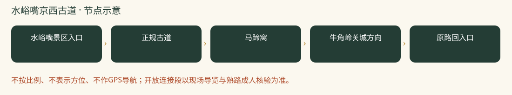

# 水峪嘴京西古道：一日攻略

> 马蹄窝＋关城＋古道探秘｜孩子一路有东西找、有故事听，适合边走边探索。｜排名6/8｜20261026-v2｜8-9岁孩子｜基准周末10月31日至11月1日。各城区出发，当天往返；未实地踩线或电话预订。

**特点：马蹄窝＋关城＋古道探秘。孩子一路有东西找、有故事听，适合边走边探索。**

## 评分

| 维度 | 0-5分 | 换算分 | 理由 |
|---|---:|---:|---|
| 秋色（25） | 3.0 | 15.0 | 古道故事比成片红叶更突出，不为红叶密度首选 |
| 儿童适配（25） | 4.0 | 20.0 | 正规景区短走可回撤，不接铁轨与隧道 |
| 交通（15） | 2.5 | 7.5 | 各城区可当天往返，但公共交通换乘、末段班次与等车时间较多 |
| 行程舒适（15） | 3.5 | 10.5 | 下山午饭可安排，山路无补给 |
| 人流体验（10） | 4.0 | 8.0 | 分散观察比登顶打卡更易组织，仍非无人 |
| 执行确定性（10） | 4.0 | 8.0 | 2025官方短线与2026景区页可对照，入口总长需现场确认 |

**总分69.0/100。** [统一评分说明](README.md#评分与排序)。

## 从全市各处怎么会合

**集合：**09:45-10:00 水峪嘴景区正式入口外集合。

**结束：**14:30-15:00。

各家庭从西城、海淀、朝阳等实际地址分别出发，在景区入口集合，不先绕到一个市区点。出门时刻=集合时刻-本家当日路线预计耗时-停车/步行20至30分钟。各方案的分钟数只是跨城排程宽预算，不是导航实测；不能把行政区当成一个固定起点。

各城区初步门到门排程预留：自驾100-160分钟；公共交通135-210分钟。这是为了约集合而留的宽缓冲，不是实时导航测算，也不表示每个区都要这么久。西城、海淀、朝阳各自以周五同一时段的导航预计耗时倒推，另加停车步行20-30分钟；远端家庭可能更久。

**自驾：**各家分别前往，不先绕到城里共同集合。导航‘京西古道风景区（水峪嘴村）’，问清正规停车场与检票入口，勿误到房山水峪村。停车位置可能改变接近距离。 以景区检票入口为集合点，导航停车场后仍要留步行时间；按上方集合时刻倒推。

**公共交通：**2025官方建议S1石厂站转M22至水峪嘴村站；本周班次未实核，需在公交官方实时查询确认。公交家庭要查去程与回程班次，不靠旧攻略固定等车时间。

**迟到：**出发前30分钟在家长群报预计抵达时刻；缓冲窗口内集合，超过窗口由领队决定全队等候还是安排成人陪迟到家庭在入口会合。不得让儿童独自在山路追队。

## 路线与景色

2025市文旅局介绍景区徒步约2.1公里、1.5-2小时；是否包括停车接近路和具体起终点须现场问清。孩子队预留2.5小时，总步行控制3-4公里，不延伸成人环线。

水峪嘴景区入口 → 正规古道 → 马蹄窝 → 牛角岭关城方向 → 原路回入口。

只走景区允许开放部分；未到关城也可折返，不把1500米保存古道当全部往返长度。不走丁家滩—铁轨—凤头岭长环线。

**打卡点**

- 马蹄窝：为什么不是一个圆坑，而是密集凹痕？
- 牛角岭石碑、关城门洞的商旅故事
- 石板路与两侧山林，用秋天的光拍纵深

**赏秋时机：**适合秋季行走，但本轮没有可靠的红叶转色比例。若目的只是满山红，北宫、西山更优；这里靠历史探索提高孩子兴趣。

## 一天怎么安排

各时间为组织建议，不是节点实测。吃饭、拍照、休息和停车接近均算进一天；能当天往返不等于必须把所有加量段走完。

| 时间 | 安排 |
|---|---|
| 09:45-10:00 | 各家分别到景区入口集合；停车、厕所、补水与点名 |
| 10:00-11:15 | 按方案正规路线开始山林步行、观景与打卡 |
| 11:15-11:30 | 温水和主食加餐；按最慢孩子调整后半段 |
| 11:30-12:30 | 继续基本线路并回到午饭点；不为赶路取消休息 |
| 12:30-13:30 | 午饭、厕所、换汗湿内层；若在山上则自带午饭 |
| 13:30-14:30 | 下午可去当日开放的马致远故居；不愿转场就村内合法道路慢走 |
| 14:30-15:00 | 在入口点名解散；各家按实际路程返城，不承诺统一到家时间 |

## 吃饭与备用午餐

12:30下山先在景区入口正规营业餐馆吃面或家常菜，建议提前一天询问接待多人儿童、厕所及可否不辣。本轮未核到可保证营业的具体餐馆，备自带主食；咖啡店不当正餐保障。饭后可自驾去马致远故居，旧20元含面套餐不照搬。

## 厕所、补水与休息

官方提醒沿途无补给，带足水。入口解决厕所；古道上不假定有洗手间。台阶、石板与浮土比公里数更决定难度。

## 门票、开放与预约

2026门头沟文旅景区页参考27元；2025报道20元、2026游客26元存在差异，以当日正规售票页为准。咨询010-61880498/61880104，核儿童优惠和开放段。

## 家庭预算

一大一小门票先留60元，午餐60-120元，故居门票及交通停车另计；不是成交价。

## 缩短路线与撤退

原路返回，雨后石板湿滑取消古道；不穿隧道、不沿废弃铁轨走、不临时涉水，不仿照攻略绕锁门。

## 给孩子的观察任务

商队任务：为什么牲畜走久会留下蹄窝？观察五个凹痕，画一条古代运货路线，不攀爬关城遗迹。

## 资料与仍待确认

原帖名义8公里，作者实际近9公里、爬升300多米并走铁轨隧道。因此不照抄‘亲子/零难度’称呼，只保留景区正规短线。2025以市文旅局正文对照。

- [2025官方短线长度、无补给与接驳](https://whlyj.beijing.gov.cn/zwgk/xwzx/gzdt/202509/t20250926_4211094.html)
- [2026景区参考票价与电话](https://www.bjmtg.gov.cn/bjmtg/c104897/202504/347022b6ab684c4c9f9e81b204153506.shtml)
- [2026-09-08，铃上木棉：古道成人环线](https://www.xiaohongshu.com/explore/6aa02805000000002900ecf0)

旧照片、成人轨迹、官方稳定规则和本周开放分开看。停车费、门票优惠、餐馆营业、接驳均须临期核实。未授权原图不打包，原帖可要求登录。

[返回方案总览](README.md) · [行前准备](出行准备与安全.md)
