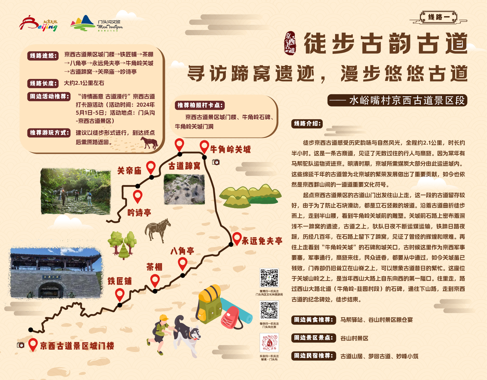
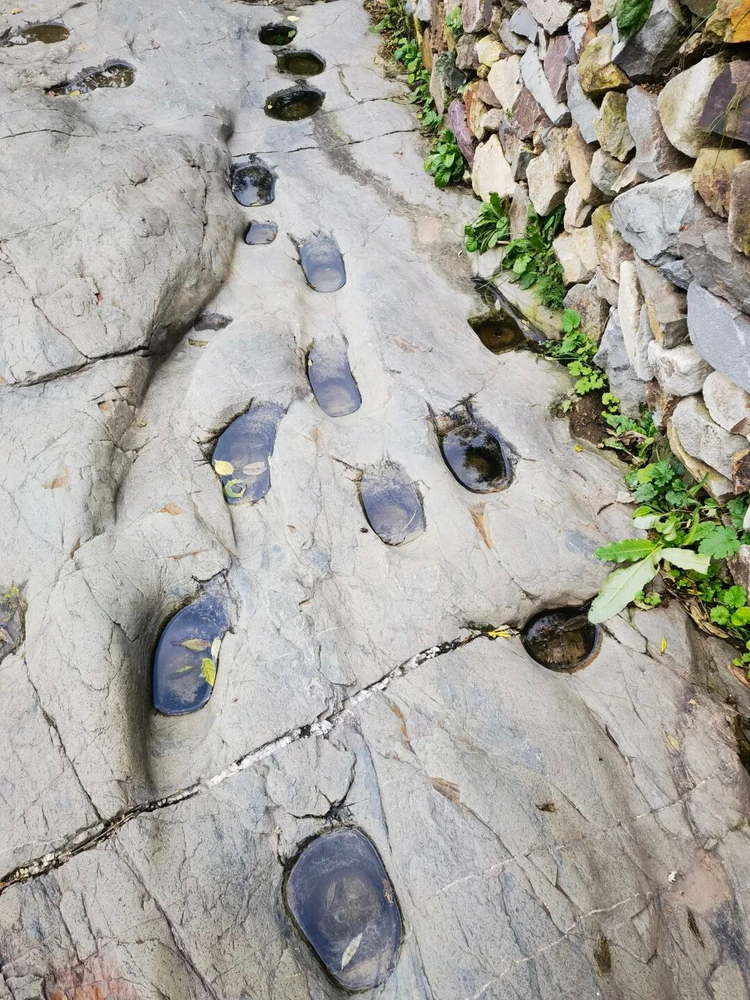
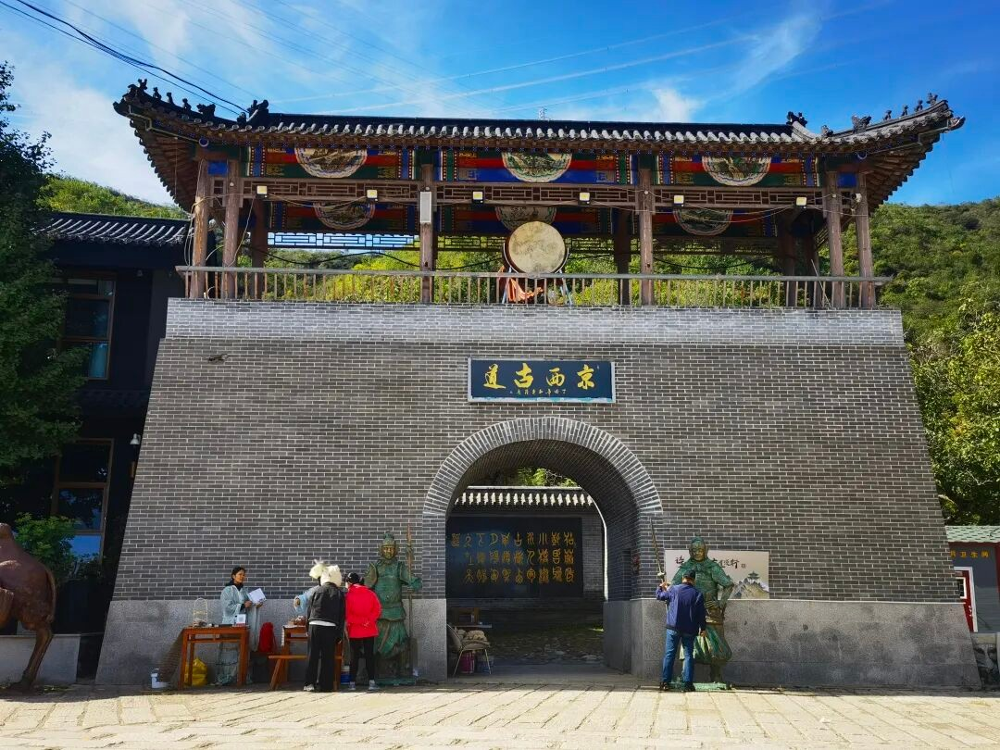
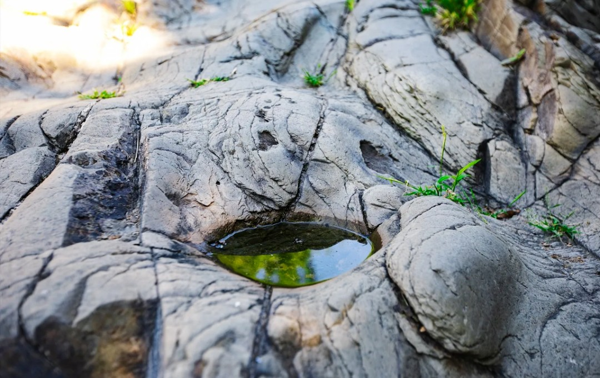

# 水峪嘴京西古道｜一日攻略

> 排名 6/8 · 69.0/100 · 适合8-9岁 · 20261026-v4

**马蹄窝＋关城＋古道探秘**

孩子一路有东西找、有故事听，适合边走边探索。

景观资料，非当季叶色；不能把文中冬夏配图当本周实况。[北京旅游网](https://www.visitbeijing.com.cn/article/4QLxdKsMG2m)。署名：北京旅游网；逐图署名见原文及素材说明。

## 先看是否适合这次组队

| 项目 | 本次安排 |
|---|---|
| 核心特点 | 马蹄窝＋关城＋古道探秘。孩子一路有东西找、有故事听，适合边走边探索。 |
| 适合谁 | 8-9岁小学生家庭，能随队走山路、按最慢孩子调整 |
| 步行与强度 | 2025市文旅局介绍景区徒步约2.1公里、1.5-2小时；是否包括停车接近路和具体起终点须现场问清。孩子队预留2.5小时，总步行控制3-4公里，不延伸成人环线。 |
| 集合 | 09:45-10:00 水峪嘴景区正式入口外集合 |
| 结束 | 14:30-15:00 |
| 午饭 | 12:30；入口餐馆或自带午餐 |
| 成行前提 | 按景区当日开放游线执行 |

## 路线图与走法

**地图来源**：[新京报刊载北京/门头沟文旅带标识路线图](https://m.bjnews.com.cn/detail/1714444627129431.html)；2024-04-30。

**本次怎么走**：从原图左下景区门楼出发，经铁匠铺、茶棚和古道蹄窝走向牛角岭关城，再原路返回同一入口。原图历史宣传的“半小时”不作儿童队用时。

**游览顺序**：景区入口门楼 → 铁匠铺·茶棚 → 古道蹄窝 → 牛角岭关城 → 原路回入口。

只走景区允许开放部分；未到关城也可折返，不把1500米保存古道当全部往返长度。不走丁家滩—铁轨—凤头岭长环线。

## 沿路最值得看的景色

- 马蹄窝：为什么不是一个圆坑，而是密集凹痕？
- 牛角岭石碑、关城门洞的商旅故事
- 石板路与两侧山林，用秋天的光拍纵深

### 京西古道深浅相叠的蹄窝

景观资料，非当季叶色；不能把文中冬夏配图当本周实况。[北京旅游网](https://www.visitbeijing.com.cn/article/4QLxdKsMG2m)。署名：北京旅游网；逐图署名见原文及素材说明。

### 挂京西古道牌匾的景区入口门楼

景观资料，非当季叶色；不能把文中冬夏配图当本周实况。[北京旅游网](https://www.visitbeijing.com.cn/article/4QLxdKsMG2m)。署名：北京旅游网；逐图署名见原文及素材说明。

### 京西古道石面上的蹄窝与积水近景

景观资料，非当季叶色；不能把文中冬夏配图当本周实况。[北京旅游网](https://www.visitbeijing.com.cn/article/4QLxdKsMG2m)。署名：北京旅游网；逐图署名见原文及素材说明。

**赏秋时机**：适合秋季行走，但本轮没有可靠的红叶转色比例。若目的只是满山红，北宫、西山更优；这里靠历史探索提高孩子兴趣。

## 一天怎么安排

时间是儿童小队的组织安排，包含加餐、午饭、休息和拍照。现场按最慢孩子调整。

| 时间 | 地点与安排 |
|---|---|
| 09:45-10:00 | 水峪嘴景区正式入口集合、厕所与点名 |
| 10:00-11:15 | 沿开放古道看马蹄窝，走向牛角岭关城 |
| 11:15-11:35 | 平整休息点加餐，按最慢孩子决定是否继续 |
| 11:35-12:30 | 原路回景区入口，不延伸成人穿越线 |
| 12:30-13:30 | 入口附近已确认营业的餐馆午饭，或在允许休息区吃自带午餐 |
| 13:30-14:30 | 同区域村落慢逛与古道观察任务，不再强制转场 |
| 14:30-15:00 | 景区入口点名解散；自驾家庭如想去故居可自行安排顺路行程 |

## 交通与集合

**集合**：09:45-10:00 水峪嘴景区正式入口外集合。

**结束**：14:30-15:00。

各家庭从西城、海淀、朝阳等实际地址分别出发，在约定的景区入口集合。先查本家当天导航，再倒推出门时刻；另留停车、进出站和步行20-30分钟。下列交通范围仅为排程宽预算，不是各行政区固定车程。

交通排程宽预算：自驾100-160分钟；公共交通135-210分钟。这是为了约集合而留的宽缓冲，不是实时导航测算，也不表示每个区都要这么久。西城、海淀、朝阳各自以周五同一时段的导航预计耗时倒推，另加停车步行20-30分钟；远端家庭可能更久。

**自驾**：导航‘京西古道风景区（水峪嘴村）’，问清正规停车场与检票入口，勿误到房山水峪村。停车位置可能改变接近距离。

**公共交通**：地铁6号线/S1到苹果园后，查询929路往陇驾庄方向，陇驾庄下车后按景区入口定位南行过水峪嘴桥。公交末段步行和返程班次须出发前查北京公交；不采用旧稿“石厂转M22至水峪嘴村”的组合。

[打开高德地图搜索集合区域](https://www.amap.com/search?query=%E4%BA%AC%E8%A5%BF%E5%8F%A4%E9%81%93%20%E6%B0%B4%E5%B3%AA%E5%98%B4%E6%9D%91)。认准正文约定的入口，地名搜索结果不是精确轨迹。

## 午饭怎么解决

12:30回入口，在提前确认营业、可接待多人儿童的正规餐馆吃面或家常菜；未落实就吃自带午餐。马致远故居放在全队解散后，由有车家庭自行决定是否顺路前往。

## 厕所、补水与休息

官方提醒沿途无补给，带足水。入口解决厕所；古道上不假定有洗手间。台阶、石板与浮土比公里数更决定难度。

## 门票与预算

2025官方资料曾列20元，更新的门头沟文旅资料列27元，按当期景区购票页或现场公示为准；儿童优惠单独核对。咨询010-61880498或010-61880104，均为公开号码，未电话核实。

## 一家一小预算参考

一大一小门票先预留60元，餐食约60-120元，另计交通停车；不是已确认儿童票价。

## 折返与特别提醒

原路返回，雨后石板湿滑取消古道；不穿隧道、不沿废弃铁轨走、不临时涉水，不仿照攻略绕锁门。

## 给孩子的观察任务

商队任务：为什么牲畜走久会留下蹄窝？观察五个凹痕，画一条古代运货路线，不攀爬关城遗迹。

## 分项评分与理由

| 维度 | 0-5分 | 换算分 | 理由 |
|---|---:|---:|---|
| 秋色（权重25） | 3.0 | 15.0 | 古道故事比成片红叶更突出，不为红叶密度首选 |
| 儿童适配（权重25） | 4.0 | 20.0 | 正规景区短走可回撤，不接铁轨与隧道 |
| 交通（权重15） | 2.5 | 7.5 | 各城区可当天往返，但公共交通换乘、末段班次与等车时间较多 |
| 行程舒适（权重15） | 3.5 | 10.5 | 下山午饭可安排，山路无补给 |
| 人流体验（权重10） | 4.0 | 8.0 | 分散观察比登顶打卡更易组织，仍非无人 |
| 执行确定性（权重10） | 4.0 | 8.0 | 2025官方短线与2026景区页可对照，入口总长需现场确认 |

**总分**：69.0/100。[统一评分说明](README.md#评分与排序)。

## 资料依据

原帖名义8公里，作者实际近9公里、爬升300多米并走铁轨隧道。因此不照抄‘亲子/零难度’称呼，只保留景区正规短线。2025以市文旅局正文对照。

- [2026门头沟文旅：古道公交与景区参考信息](https://xinwen.bjd.com.cn/content/s6ab0f7aad5de4aef00ef9104.html)
- [2025官方短线长度、无补给与接驳](https://whlyj.beijing.gov.cn/zwgk/xwzx/gzdt/202509/t20250926_4211094.html)
- [2026景区参考票价与电话](https://www.bjmtg.gov.cn/bjmtg/c104897/202504/347022b6ab684c4c9f9e81b204153506.shtml)
- [2026-09-08，铃上木棉：古道成人环线](https://www.xiaohongshu.com/explore/6aa02805000000002900ecf0)

照片只说明景观特点，历史图片不代表本周叶色。地图按来源标注，地区底图不是已验证的同线轨迹；当天开放、票务和公交以官方信息为准。共同装备与集合规则见[行前准备](出行准备与安全.md)。

[返回总览](README.md) · [图片与地图署名](assets/README.md)
