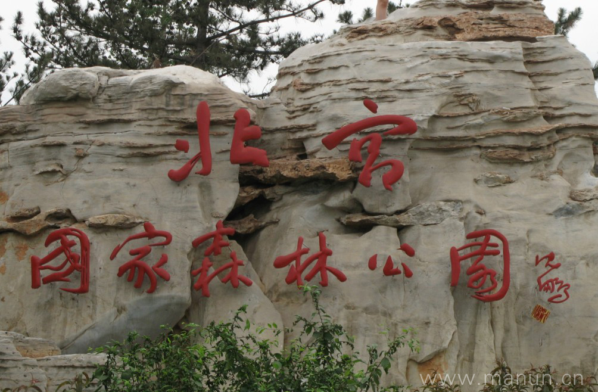

# 北宫国家森林公园：一日攻略

> 彩林与登山均衡之选｜本轮排名 1｜资料整理：2026-10-26｜基准周末：10月31日至11月1日。8-9岁多孩小队，山林徒步优先。未实地踩线、未电话预订。

## 怎么选与评分

| 维度 | 0-5分 | 权重 | 换算得分 | 理由 |
|---|---:|---:|---:|---|
| 秋色 | 4.5 | 25 | 22.5 | 黄栌与多种彩叶，官方预报窗口覆盖目标周末；仍非全山通红 |
| 儿童适配 | 4.5 | 25 | 22.5 | 低位山林可随时折返，登狼坡顶只是自选加量 |
| 交通 | 3.5 | 15 | 10.5 | 市区西部较近，公交末段仍要走约1公里 |
| 行程舒适 | 4.5 | 15 | 13.5 | 山林、小江南与市集能安排动静交替 |
| 人流体验 | 3.5 | 10 | 7.0 | 热度上升，早到比相信‘免费人少’可靠 |
| 执行确定性 | 4.0 | 10 | 8.0 | 近期游客记录与当季官方活动吻合，停车和活动细节仍需临期核对 |

**总分：84.0/100。** 主观规划分，不是景区评级；见[评分规则](README.md#评分规则)。

## 路线、景色与体力

基本版控制3-4公里，含休息约3小时；不是实测轨迹，停车接近路另计。狼坡顶只给全队有余力时加选，总步行控制5公里左右；未核累计爬升。

南门 → 小江南 → 开放彩林步道 → 原路折返 → 南门午饭。

狼坡顶不作为必达点；若选登顶，入园先向工作人员确认上下山连接与预计总长，不临场追随网上大环线。

**打卡点**

- 小江南：水面、桥与彩树同框
- 正规步道的黄栌林：逆光看圆形叶片
- 体力允许才加狼坡顶，登高看层次，不为纪念礼强登顶

**今年时机：**2026-10-18丰台官方预报预计10月26日至11月10日为较佳窗口；10月25日游客目测红叶约四至五成、黄栌较红。这是预报与个人观察，不能换算成周末保证。

## 一天怎么安排

时间为组织建议，不是实测到达时间；每段按最慢孩子调整，取消后半段也算完成。

| 时间 | 安排 |
|---|---|
| 08:00 | 市区西部出发，早餐在车程前吃完 |
| 09:00-09:25 | 南门集合、厕所、确认导览与折返点 |
| 09:25-10:15 | 小江南慢走，拍水面彩林 |
| 10:15-11:45 | 正规彩林步道短上坡；11:00做体力检查，疲惫即返 |
| 12:00-13:00 | 南门区域午饭与换汗湿衣物 |
| 13:00-14:00 | 允许休息区自然笔记、平缓散步，不再补登顶 |
| 14:00-15:30 | 返程；拥堵另加缓冲 |

## 自驾与停车

市区西部出发约50-80分钟的组织预算，导航‘北宫国家森林公园南门停车场（途经枫林路）’。仅停现场指挥的合法停车位；09:00前到，停车接近步行另留20分钟。近期游客报10元/次，仅参考现场牌价。

## 公共交通

地铁14号线张郭庄站A口换385路，或843路至北宫森林公园站，再步行约1公里到南门。这段步行要算进孩子全天体力，不因免票忽略接驳。公交实时班次出发前查。

## 午饭怎么解决

12:00左右回南门区域，先找有座位的市集主食，选择面、饼或饭加蛋白质，不把烤肠甜点当午餐。摊位供应和座位未保证，每个家庭带一份可直接食用主食；排队超过15分钟就启用自带午餐。在允许休息区用餐，不生火。

## 厕所、补水与休息

入园先问南门和小江南一带当日开放厕所、最后一处上山厕所；山上不依赖售货点。允许休息区可做落叶观察，动物区只观看，不投喂。

## 门票、开放与预约

北京旅游网景区页列免费、旺季6:30-19:00。是否需登记及临时封段以园方当天公告为准。咨询010-83840830；市集、体验和停车另计，不把入园免费理解为项目全免费。

## 家庭预算

一大一小自带饭约40-80元，现场简餐约80-150元；另加交通停车。为预算估算，不是套餐价。

## 缩短路线、天气与撤退

任何孩子膝腿不适即沿已走过的正规步道返回南门。午后不新开山路；大风、降雨或步道湿滑则取消登山。

## 给孩子的任务

分组找三种叶形并画下来；比较同一棵树向阳与背阴叶色。只拍照、不摘叶，不跑下坡。

照片：www.manun.cn，2010-11-07原始上传，CC BY 3.0；仅作历史景观参考，不是2026叶色情况。完整来源见[图片署名](assets/README.md)。

## 资料、近期经验与未知项

采用近期实走的早到停车、黄栌已红而其他树未全红信息；不把游客目测百分比当气象监测。2025年以官方秋季资料对照，未取得匹配的2025小红书完整原帖。

- [2026北宫彩叶季、公交与停车入口（丰台区文旅局）](https://www.bjft.gov.cn/ftq/xwdt/jcdt/bmdt/202610/t20261016_227463.shtml)
- [门票、电话与开放时间（北京旅游网）](https://s.visitbeijing.com.cn/index.php/attraction/117723)
- [2025秋季对照：西山与北宫（市政府）](https://www.beijing.gov.cn/renwen/rwzyd/xltj/202510/t20251028_4241918.html)
- [2026-10-25，super汉堡妈：红叶与南门停车实况（小红书原帖）](https://www.xiaohongshu.com/explore/6ade015a0000000031039577)

小红书仅采用作者公开经验，里程与停车费未经独立实测；原帖可能要求登录。未复制全文或把旧照片当今年现场。图片原帖可点来源查看，未取得转载许可的不打包进仓库。

[返回总览与评分](README.md) · [天气与队伍准备](出行准备与安全.md)
