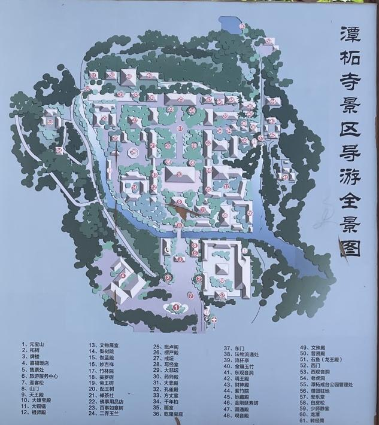
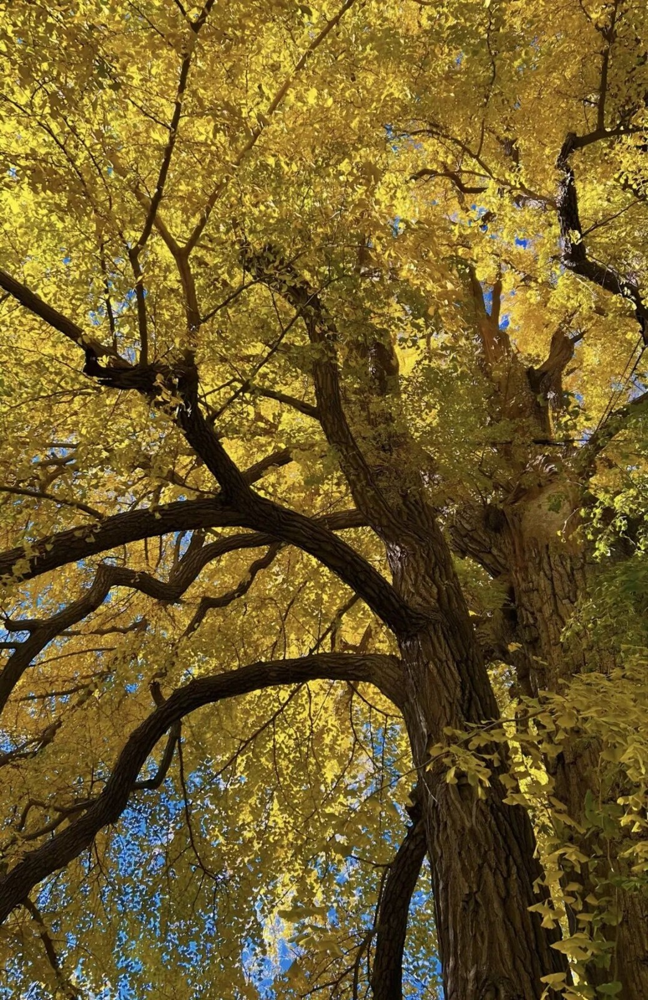
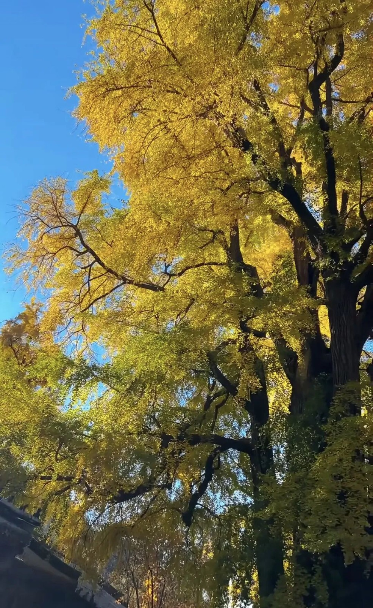

# 潭柘寺古银杏慢游｜一日攻略

> 排名 7/8 · 66.0/100 · 适合8-9岁 · 20261026-v4

**古银杏＋红墙＋千年古建**

最适合专门看银杏、拍照和慢慢逛，运动量较少。

2025往年秋色资料，不代表今年实况。[北京旅游网](https://www.visitbeijing.com.cn/article/4P0SilHTGYk)。署名：北京旅游网潭柘寺段标注小红书@阿茉aMore；依原文署名保留。

## 先看是否适合这次组队

| 项目 | 本次安排 |
|---|---|
| 核心特点 | 古银杏＋红墙＋千年古建。最适合专门看银杏、拍照和慢慢逛，运动量较少。 |
| 适合谁 | 8-9岁小学生家庭，能随队走山路、按最慢孩子调整 |
| 步行与强度 | 寺内控制2-3公里、2.5-3小时，循正规参观路慢慢上阶。它是山地寺院慢游，不包装成爬山环线。 |
| 集合 | 09:45-10:00 潭柘寺正式入口外集合 |
| 结束 | 14:30-15:00 |
| 午饭 | 12:30；自带午餐为主 |
| 成行前提 | 按景区当日开放游线执行 |

## 路线图与走法

**地图来源**：[携程游记实拍入口景区导游全景图；裁出右侧地图与原有图例](https://gs.ctrip.com/html5/you/travels/120093/4023691.html)；游客实拍，拍摄日期未核。

**本次怎么走**：按原图编号8山门—9天王殿—10大雄宝殿—19帝王树与20配王树—25毗卢阁开放区，沿正规参观路回山门。午饭安排寺内允许休息处，一次出园。

**游览顺序**：正式山门 → 主殿区域 → 帝王树·配王树 → 开放上层院落 → 原路回山门。

不从后山翻进寺，不接广慧寺环穿、定都阁、孔雀庵与天坑。一日只游一寺，午后增加观察和休息而非补另一山头。

## 沿路最值得看的景色

- 帝王树、配王树与古建屋檐
- 红墙与扇形银杏叶近景
- 开放院落的高低台阶与秋山背景，不保证能上某一楼阁

### 潭柘寺银杏与古建飞檐

2025往年秋色资料，不代表今年实况。[北京旅游网](https://www.visitbeijing.com.cn/article/4P0SilHTGYk)。署名：北京旅游网原文配图；部分潭柘寺段标注小红书@阿茉aMore，其他未逐图明确作者。

### 潭柘寺仰望金色银杏枝叶

2025往年秋色资料，不代表今年实况。[北京旅游网](https://www.visitbeijing.com.cn/article/4P0SilHTGYk)。署名：北京旅游网原文配图；部分潭柘寺段标注小红书@阿茉aMore，其他未逐图明确作者。

### 潭柘寺银杏枝叶与秋日天空

2025往年秋色资料，不代表今年实况。[北京旅游网](https://www.visitbeijing.com.cn/article/4P0SilHTGYk)。署名：北京旅游网原文配图；部分潭柘寺段标注小红书@阿茉aMore，其他未逐图明确作者。

### 潭柘寺山门与秋日黄叶

2025-11-09实拍，往年秋景。[Wikimedia Commons · N509FZ](https://commons.wikimedia.org/wiki/File:Entrance_gatetower_of_Tanzhe_Temple_(20251109144630).jpg)。署名：N509FZ · CC BY-SA 4.0。

**赏秋时机**：2026银杏节10月24日启幕，10月25日官方报道向阳侧开始黄，未全黄；建议目标周末临期再看实拍，纯追金黄可考虑11月上旬，但不保证具体哪天。

## 一天怎么安排

时间是儿童小队的组织安排，包含加餐、午饭、休息和拍照。现场按最慢孩子调整。

| 时间 | 地点与安排 |
|---|---|
| 09:45-10:00 | 正式山门外集合，厕所与点名 |
| 10:00-11:15 | 依正规参观线路看主殿、帝王树与配王树 |
| 11:15-11:35 | 加餐休息，欣赏古树和院落 |
| 11:35-12:30 | 走开放的上层院落，看古建细节与山林 |
| 12:30-13:15 | 寺内允许休息处吃自带午餐，保持安静并带走垃圾 |
| 13:15-14:15 | 古树与古建手帐、自由拍照，沿参观路缓缓返回 |
| 14:15-14:30 | 缓缓回到山门，准备一次出园 |
| 14:30-15:00 | 山门出口点名解散；想吃热饭的家庭此后在门口用餐 |

## 交通与集合

**集合**：09:45-10:00 潭柘寺正式入口外集合。

**结束**：14:30-15:00。

各家庭从西城、海淀、朝阳等实际地址分别出发，在约定的景区入口集合。先查本家当天导航，再倒推出门时刻；另留停车、进出站和步行20-30分钟。下列交通范围仅为排程宽预算，不是各行政区固定车程。

交通排程宽预算：自驾110-180分钟；公共交通150-240分钟。这是为了约集合而留的宽缓冲，不是实时导航测算，也不表示每个区都要这么久。西城、海淀、朝阳各自以周五同一时段的导航预计耗时倒推，另加停车步行20-30分钟；远端家庭可能更久。

**自驾**：导航潭柘寺景区正规停车场，银杏季另留30分钟排队。入口不与桑峪村古道起点混用。

**公共交通**：地铁6号线/S1至苹果园，转931路潭柘寺方向至终点，再按正规入口步行。出发前在北京公交确认当日站台与返程班次；金安桥西也可作为沿途换乘点，不能将之称为已迁的新始发。

[打开高德地图搜索集合区域](https://www.amap.com/search?query=%E6%BD%AD%E6%9F%98%E5%AF%BA)。认准正文约定的入口，地名搜索结果不是精确轨迹。

## 午饭怎么解决

主方案寺内在允许休息处吃自带午餐，避免出园后依赖二次入园。想吃热饭的家庭可在全部参观结束、一次出园后，到寺门口正规餐馆用餐；出发前确认营业、多人座位及不辣主食。寺内咖啡不作为全队午餐保障。

## 厕所、补水与休息

入寺先问厕所位置；热门树下不久坐挡路。银杏果不捡食，皮肤敏感孩子不触摸果肉。仅在允许区域观察自然落叶。

## 门票与预算

北京旅游网参考成人50元、8:30-16:30。儿童优惠本轮未完整核准，带证件并在景区正式购票入口核实。010-60862505/60861699；活动演出时间另看当日公告。

## 一家一小预算参考

一大一小门票先留100元、午餐60-120元，交通停车另计；未按未知儿童政策计算优惠。

## 折返与特别提醒

树叶未黄也不改走未知后山；台阶湿滑只在低位开放院落慢游。若唯一目标是登山运动，改选前四项。

## 给孩子的观察任务

比较两株古树叶色差异，记录向阳背阴。画一扇叶片，寻找二叉分枝的叶脉，不给树龄争议编造精确答案。

## 分项评分与理由

| 维度 | 0-5分 | 换算分 | 理由 |
|---|---:|---:|---|
| 秋色（权重25） | 4.0 | 20.0 | 古树与古建观赏价值高，但10月25日仅向阳侧开始黄 |
| 儿童适配（权重25） | 3.0 | 15.0 | 台阶慢游易控制，本次按登山兴趣评分所以降权 |
| 交通（权重15） | 2.0 | 6.0 | 银杏季末段拥堵，各城区路程差异大；自驾与公交都需要完整一天 |
| 行程舒适（权重15） | 4.0 | 12.0 | 寺院慢游可充分休息，午饭有备份安排 |
| 人流体验（权重10） | 2.5 | 5.0 | 核心古树处客流集中，不承诺空镜 |
| 执行确定性（权重10） | 4.0 | 8.0 | 官方当季状态清楚，餐馆营业与儿童票仍须核准 |

**总分**：66.0/100。[统一评分说明](README.md#评分与排序)。

## 资料依据

采用近期素餐可询问清淡主食的经验，不把未写店名的面馆伪造成可预订店。2025图片来自官方编辑引用小红书作者，未冒充直接读过该作者原帖。

- [2026-10-25门头沟官方发布：开始变黄](https://xinwen.bjd.com.cn/content/s6addcdedd5def922be1bbbd4.html?innerId=1)
- [景区票价与公开电话](https://s.visitbeijing.com.cn/attraction/117841)
- [2025-11-05银杏实况含11月2日图片来源](https://www.visitbeijing.com.cn/article/4P0SilHTGYk)
- [2026-10-21，黄金颜如：门口素面与叶色反馈](https://www.xiaohongshu.com/explore/6ad75e6a000000002f030e30)

照片只说明景观特点，历史图片不代表本周叶色。地图按来源标注，地区底图不是已验证的同线轨迹；当天开放、票务和公交以官方信息为准。共同装备与集合规则见[行前准备](出行准备与安全.md)。

[返回总览](README.md) · [图片与地图署名](assets/README.md)
