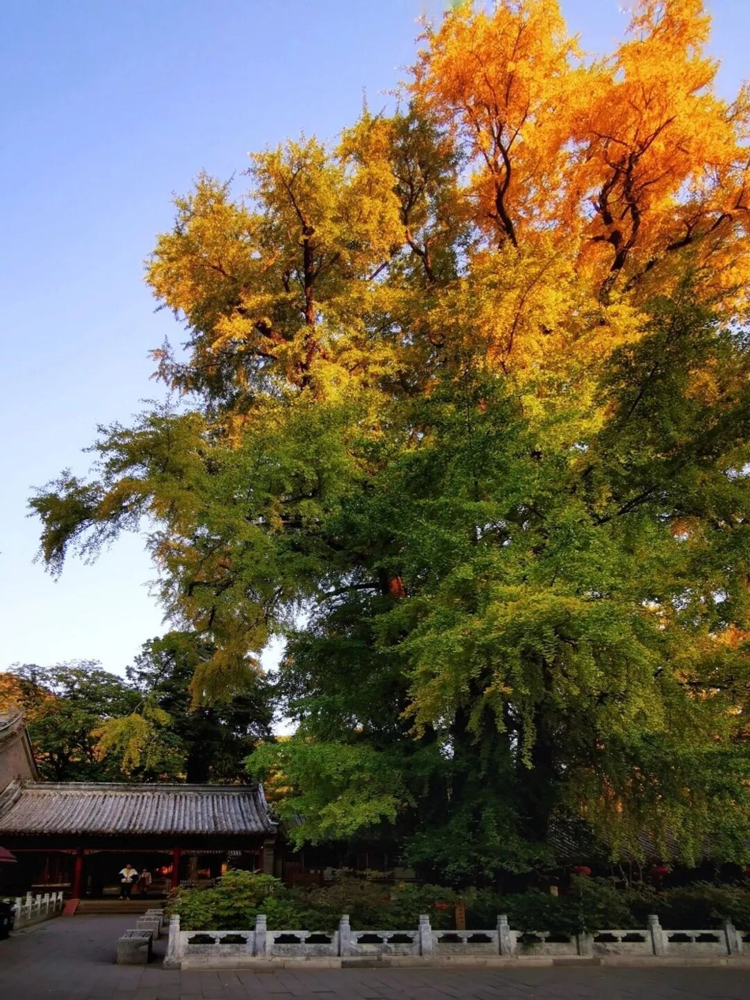
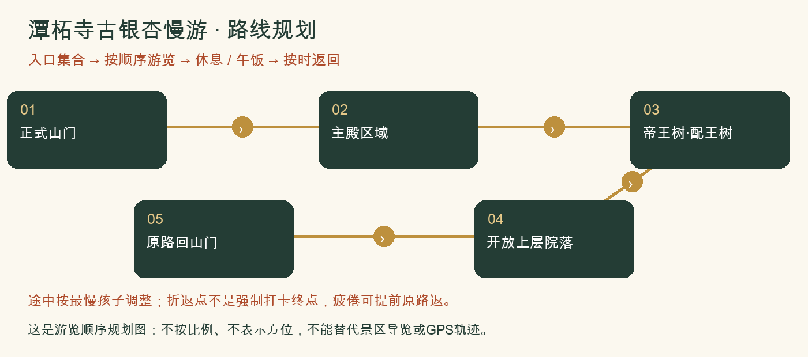
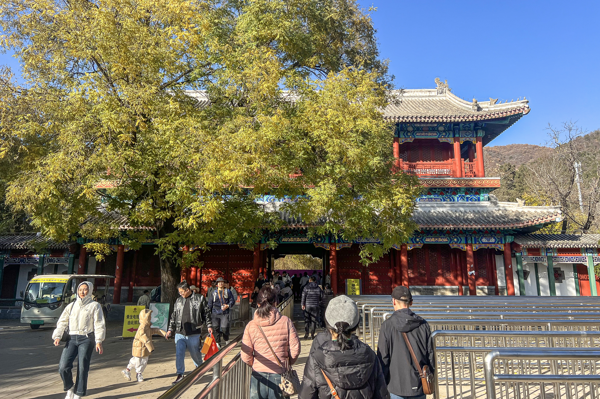

# 潭柘寺古银杏慢游：一日攻略

> 古银杏＋红墙＋千年古建｜最适合专门看银杏、拍照和慢慢逛，运动量较少。｜排名7/8｜20261026-v3｜8-9岁孩子｜基准周末10月31日至11月1日。各城区出发，当天往返；未实地踩线或电话预订。

**特点：古银杏＋红墙＋千年古建。最适合专门看银杏、拍照和慢慢逛，运动量较少。**

*潭柘寺古银杏高大树冠。2025-11-05发布的往年秋色资料；非今年实况。[图片来源：北京旅游网](https://www.visitbeijing.com.cn/article/4P0SilHTGYk)。*

*潭柘寺金色银杏枝叶。2025-11-05发布的往年秋色资料；非今年实况。[图片来源：北京旅游网](https://www.visitbeijing.com.cn/article/4P0SilHTGYk)。*

## 评分

| 维度 | 0-5分 | 换算分 | 理由 |
|---|---:|---:|---|
| 秋色（25） | 4.0 | 20.0 | 古树与古建观赏价值高，但10月25日仅向阳侧开始黄 |
| 儿童适配（25） | 3.0 | 15.0 | 台阶慢游易控制，本次按登山兴趣评分所以降权 |
| 交通（15） | 2.0 | 6.0 | 银杏季末段拥堵，各城区路程差异大；自驾与公交都需要完整一天 |
| 行程舒适（15） | 4.0 | 12.0 | 寺院慢游可充分休息，午饭有备份安排 |
| 人流体验（10） | 2.5 | 5.0 | 核心古树处客流集中，不承诺空镜 |
| 执行确定性（10） | 4.0 | 8.0 | 官方当季状态清楚，餐馆营业与儿童票仍须核准 |

**总分66.0/100。** [统一评分说明](README.md#评分与排序)。

## 从全市各处怎么会合

**集合：**09:45-10:00 潭柘寺正式入口外集合。

**结束：**14:30-15:00。

各家庭从西城、海淀、朝阳等实际地址分别出发，在景区入口集合，不先绕到一个市区点。出门时刻=集合时刻-本家当日路线预计耗时-停车/步行20至30分钟。各方案的分钟数只是跨城排程宽预算，不是导航实测；不能把行政区当成一个固定起点。

各城区初步门到门排程预留：自驾110-180分钟；公共交通150-240分钟。这是为了约集合而留的宽缓冲，不是实时导航测算，也不表示每个区都要这么久。西城、海淀、朝阳各自以周五同一时段的导航预计耗时倒推，另加停车步行20-30分钟；远端家庭可能更久。

**自驾：**各家分别前往，不先绕到城里共同集合。导航潭柘寺景区正规停车场，银杏季另留30分钟排队。入口不与桑峪村古道起点混用。 以景区检票入口为集合点，导航停车场后仍要留步行时间；按上方集合时刻倒推。

**公共交通：**旧官方指引为苹果园换931路，当前接驳与发车间隔需北京公交临期核对。自驾或合适接驳均可，不把旧文班次当保证。

**迟到：**出发前30分钟在家长群报预计抵达时刻；缓冲窗口内集合，超过窗口由领队决定全队等候还是安排成人陪迟到家庭在入口会合。不得让儿童独自在山路追队。

## 路线与景色

寺内控制2-3公里、2.5-3小时，循正规参观路慢慢上阶。它是山地寺院慢游，不包装成爬山环线。

正式山门 → 主殿区域 → 帝王树·配王树 → 开放上层院落 → 原路回山门。

不从后山翻进寺，不接广慧寺环穿、定都阁、孔雀庵与天坑。一日只游一寺，午后增加观察和休息而非补另一山头。

**打卡点**

- 帝王树、配王树与古建屋檐
- 红墙与扇形银杏叶近景
- 开放院落的高低台阶与秋山背景，不保证能上某一楼阁

**赏秋时机：**2026银杏节10月24日启幕，10月25日官方报道向阳侧开始黄，未全黄；建议目标周末临期再看实拍，纯追金黄可考虑11月上旬，但不保证具体哪天。

## 一天怎么安排

各时间为组织建议，不是节点实测。吃饭、拍照、休息和停车接近均算进一天；能当天往返不等于必须把所有加量段走完。

| 时间 | 安排 |
|---|---|
| 09:45-10:00 | 各家分别到景区入口集合；停车、厕所、补水与点名 |
| 10:00-11:15 | 按方案正规路线开始山林步行、观景与打卡 |
| 11:15-11:30 | 温水和主食加餐；按最慢孩子调整后半段 |
| 11:30-12:30 | 继续基本线路并回到午饭点；不为赶路取消休息 |
| 12:30-13:30 | 午饭、厕所、换汗湿内层；若在山上则自带午饭 |
| 13:30-14:30 | 午后古树与古建手帐，单寺深游；出园用餐前先确认能否二次进入 |
| 14:30-15:00 | 在入口点名解散；各家按实际路程返城，不承诺统一到家时间 |

## 吃饭与备用午餐

12:30选寺门口正规素餐馆，点清汤面或炸酱另放的面食，先确认不辣与座位。近期原帖提到门口素餐馆但未写可靠店名，不伪造指定店。嘉福宾舍素食餐厅仅作待电话确认候选；备自带主食，不把寺内加福咖啡当午餐。

## 厕所、补水与休息

入寺先问厕所位置；热门树下不久坐挡路。银杏果不捡食，皮肤敏感孩子不触摸果肉。仅在允许区域观察自然落叶。

## 门票、开放与预约

北京旅游网参考成人50元、8:30-16:30。儿童优惠本轮未完整核准，带证件并在景区正式购票入口核实。010-60862505/60861699；活动演出时间另看当日公告。

## 家庭预算

一大一小门票先留100元、午餐60-120元，交通停车另计；未按未知儿童政策计算优惠。

## 缩短路线与撤退

树叶未黄也不改走未知后山；台阶湿滑只在低位开放院落慢游。若唯一目标是登山运动，改选前四项。

## 给孩子的观察任务

比较两株古树叶色差异，记录向阳背阴。画一扇叶片，寻找二叉分枝的叶脉，不给树龄争议编造精确答案。

N509FZ，2025-11-09，CC BY-SA 4.0；不是本周叶色，也不是帝王树定位图。[完整署名](assets/README.md)。

## 资料与仍待确认

采用近期素餐可询问清淡主食的经验，不把未写店名的面馆伪造成可预订店。2025图片来自官方编辑引用小红书作者，未冒充直接读过该作者原帖。

- [2026-10-25门头沟官方发布：开始变黄](https://xinwen.bjd.com.cn/content/s6addcdedd5def922be1bbbd4.html?innerId=1)
- [景区票价与公开电话](https://s.visitbeijing.com.cn/attraction/117841)
- [2025-11-05银杏实况含11月2日图片来源](https://www.visitbeijing.com.cn/article/4P0SilHTGYk)
- [2026-10-21，黄金颜如：门口素面与叶色反馈](https://www.xiaohongshu.com/explore/6ad75e6a000000002f030e30)

旧照片、成人轨迹、官方稳定规则和本周开放分开看。停车费、门票优惠、餐馆营业、接驳均须临期核实。照片出处与时间见图下注及图片署名页；原帖可要求登录。

[返回方案总览](README.md) · [行前准备](出行准备与安全.md)
