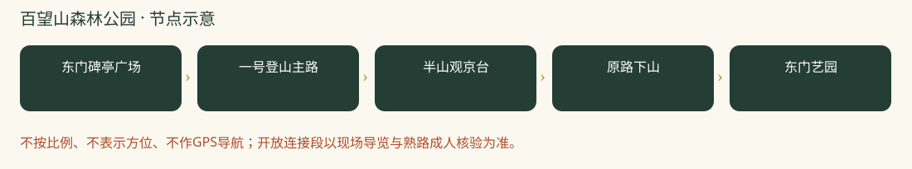

# 百望山森林公园：一日攻略

> 地铁友好，首次组队最稳｜本轮排名 2｜资料整理：2026-10-26｜基准周末：10月31日至11月1日。8-9岁多孩小队，山林徒步优先。未实地踩线、未电话预订。

## 怎么选与评分

| 维度 | 0-5分 | 权重 | 换算得分 | 理由 |
|---|---:|---:|---:|---|
| 秋色 | 3.5 | 25 | 17.5 | 彩叶丰富但当季原帖叶色判断不一，不承诺满山红 |
| 儿童适配 | 4.5 | 25 | 22.5 | 可只走东门至半山，不把20分钟登顶宣传当儿童用时 |
| 交通 | 4.5 | 15 | 13.5 | 16号线马连洼可达，适合各家地铁集合 |
| 行程舒适 | 4.5 | 15 | 13.5 | 东门与半山有当季驿站、市集，可先解决午饭 |
| 人流体验 | 3.5 | 10 | 7.0 | 周末有客流，东门集合仍比远山更好组织 |
| 执行确定性 | 4.5 | 10 | 9.0 | 当季官方节点与设施信息较完整，特定栈道开放仍须确认 |

**总分：83.0/100。** 主观规划分，不是景区评级；见[评分规则](README.md#评分规则)。

## 路线、景色与体力

东门往返基本版控制3-4公里，约2.5-3小时含休息；地铁站往返步行额外约1.4-2公里。海拔210米不是累计爬升。

东门碑亭广场 → 一号登山主路 → 半山观京台 → 原路下山 → 东门艺园。

全队体力好且导览确认路段开放，才从半山继续至佘太君庙方向再返；不默认拼接北门222/291环线。

**打卡点**

- 观京台：有城市背景的山林合影
- 主路彩叶：用落叶辨黄栌、元宝枫与银杏
- 东门碑亭与林间光影：适合队伍合照

**今年时机：**2026秋季市集至11月15日；2025官方报道说明多树种赏秋特点，不能照搬去年兑换活动。10月下旬近期原帖对红叶程度意见不同，按局部彩叶而非满山红安排。

## 一天怎么安排

时间为组织建议，不是实测到达时间；每段按最慢孩子调整，取消后半段也算完成。

| 时间 | 安排 |
|---|---|
| 08:30-09:00 | 各家庭到马连洼站集合 |
| 09:00-09:30 | 步行至东门，厕所、读图、点名 |
| 09:30-11:15 | 沿一号登山主路到观京台；每30-40分钟休息 |
| 11:15-12:00 | 原路下山；不赶速度抢午饭 |
| 12:00-13:00 | 东门艺园午饭、休息 |
| 13:00-14:00 | 碑亭区域找叶形、自然笔记与慢走 |
| 14:00-15:15 | 步行回地铁站，各家庭返程 |

## 自驾与停车

市区西部出发约45-70分钟预算，导航百望山森林公园东门及正规停车场。不要按北门停车经验安排东门接人。

## 公共交通

建议16号线马连洼站集合，A口到东门约700-1000米，儿童步行留15-25分钟。各家庭先到站再共同走；出发前核对出入口临时管制。

## 午饭怎么解决

12:00前回东门艺园，官方列披萨等简餐；半山观京台列热干面、牛肉饼，可作途中补能。先问座位、是否可做不辣，再点餐。每家自带主食作市集未开或排队备份；不为一摊饭额外爬山。

## 厕所、补水与休息

东门先上厕所并问清观京台最近开放厕所。驿站可休息，不能推断每站都有厕所或免费热水；自带温水。

## 门票、开放与预约

成人参考6元；通过‘北京市海淀百望山森林公园’官方公众号查看购票与儿童优惠，带儿童有效证件，不预设免费。当季官方列旺季6:00-18:00，静园20:00；本方案14:00前结束。咨询010-62884356（历史公开电话，临期核实）。

## 家庭预算

一大一小门票先预留12元，餐食约60-120元，地铁另计；不是儿童票价认定。

## 缩短路线、天气与撤退

半山观京台就是完整基本版终点；任何孩子疲倦即原路返。北门游客的‘两小时4公里’不等于本队实走承诺，陡阶291不作下山捷径。

## 给孩子的任务

给同一座山画三种观察图：叶片近景、树冠中景、观京台远景。比较为什么颜色看起来不同。

## 资料、近期经验与未知项

北门原帖提供栈道和陡阶差别，因此本队采用官方东门主路而非照抄北门环线。2025使用林草局秋季报道，未取得匹配的2025小红书完整原帖。

- [2026官方市集、餐饮、驿站与开放时段](https://www.beijing.gov.cn/fuwu/bmfw/sy/jrts/202610/t20261012_4898421.html)
- [2025秋季四种游线与树种（国家林草局）](https://www.forestry.gov.cn/c/www/lcstly/647261.jhtml)
- [2026票价与马连洼接驳（北京号）](https://xinwen.bjd.com.cn/content/s69b2ad52d5dedd6a22eec94f.html?innerId=1)
- [2026-10-25，Catherine：北门4公里环线（小红书原帖）](https://www.xiaohongshu.com/explore/6adc63eb0000000024039af8)

小红书仅采用作者公开经验，里程与停车费未经独立实测；原帖可能要求登录。未复制全文或把旧照片当今年现场。图片原帖可点来源查看，未取得转载许可的不打包进仓库。

[返回总览与评分](README.md) · [天气与队伍准备](出行准备与安全.md)
