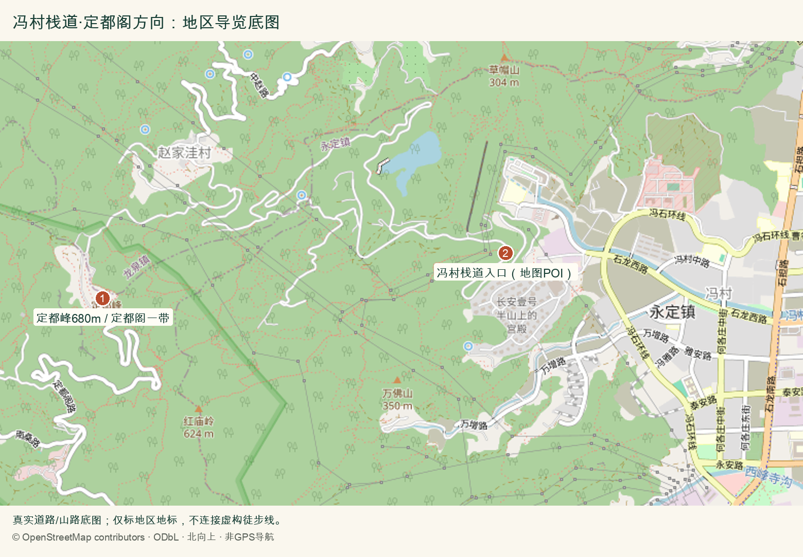
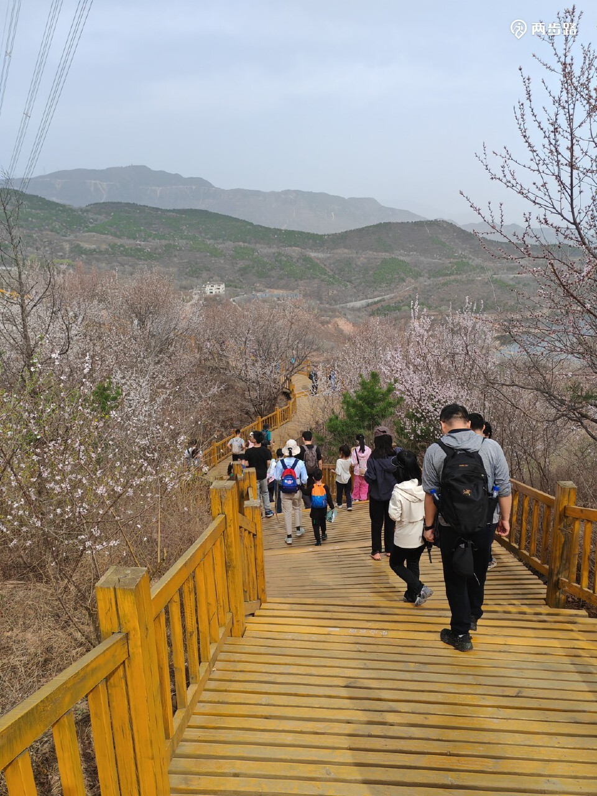
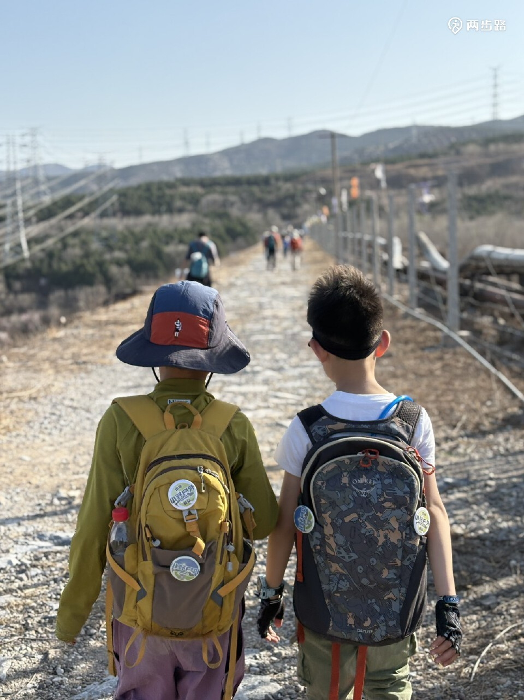
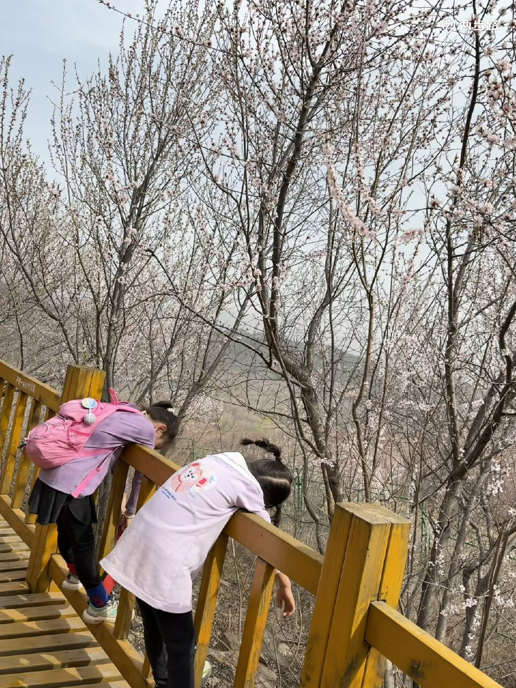

# 冯村栈道·定都阁远眺｜一日攻略

> 排名 8/8 · 58.5/100 · 适合8-9岁 · 20261026-v4

**栈道登山＋开阔山景＋远眺定都阁**

走得更像一次爬山，按时间折返，路程可控。

2025春季桃花/地形资料，不能当秋色；不复制旧长环线与锁门绕行做法。[两步路·乐天（HikerTan）亲子实走游记](https://www.2bulu.com/community/gotohuatinfo.htm?id=UQ30N68rQSzVf3tcNf0S8A%3D%3D&type=1)。署名：乐天（HikerTan）/北京小野户外，保留两步路水印；公开原帖不等于取得转载授权。

## 先看是否适合这次组队

| 项目 | 本次安排 |
|---|---|
| 核心特点 | 栈道登山＋开阔山景＋远眺定都阁。走得更像一次爬山，按时间折返，路程可控。 |
| 适合谁 | 8-9岁小学生家庭，能随队走山路、按最慢孩子调整 |
| 步行与强度 | 从熟路领队确认的冯村正规入口沿木栈道往返，11:45停止向上。总步行以约4-6公里为控制目标，不保证到千层石；2024同线资料显示千层石距起点约3.05公里，到那里往返已约6.1公里，另加停车接近路。 |
| 集合 | 09:30 冯村正规栈道合法入口，熟路成人提前发实际定位 |
| 结束 | 14:30-15:00 同一入口 |
| 午饭 | 11:45；自带午餐为主 |
| 成行前提 | 需熟路领队确认入口与通行后成行 |

## 路线图与走法

**地图来源**：[OpenStreetMap地区底图与地标标注](https://www.openstreetmap.org/#map=14/39.9040/116.0500)；2026-10-26读取；地标与真实道路参考，非同线GPX。

**本次怎么走**：从图上②冯村栈道地图POI附近，由领队确认的正规入口沿实际栈道向山林行进，再原路返回。图上①是定都峰/定都阁方向，不是本次必达终点；千层石精确位置未在底图核定。11:45停止向上，不把12公里长线拼进短返。

**游览顺序**：冯村合法入口 → 正规木栈道 → 千层石方向 → 观景后折返 → 回原入口。

成行前必须由熟路领队确认具体入口、当日通行和同一条往返路线；没有确认就改选前列景区。只走栈道往返，不走旧12公里不老泉环线，不安排登阁。

## 沿路最值得看的景色

- 正规黄色木栈道：实际路线体验
- 开放观景处远眺定都阁：以天气与视线为准
- 千层石是远端参考点，不作为本队必须到达的目标

### 冯村黄色木栈道与亲子实走

2025春季桃花/地形资料，不能当秋色；不复制旧长环线与锁门绕行做法。[两步路·乐天（HikerTan）亲子实走游记](https://www.2bulu.com/community/gotohuatinfo.htm?id=UQ30N68rQSzVf3tcNf0S8A%3D%3D&type=1)。署名：乐天（HikerTan）/北京小野户外，保留两步路水印；公开原帖不等于取得转载授权。

### 冯村线路起步山路与远山

2025春季桃花/地形资料，不能当秋色；不复制旧长环线与锁门绕行做法。[两步路·乐天（HikerTan）亲子实走游记](https://www.2bulu.com/community/gotohuatinfo.htm?id=UQ30N68rQSzVf3tcNf0S8A%3D%3D&type=1)。署名：乐天（HikerTan）/北京小野户外，保留两步路水印；公开原帖不等于取得转载授权。

### 冯村木栈道栏杆与沿途观察

2025春季桃花/地形资料，不能当秋色；不复制旧长环线与锁门绕行做法。[两步路·乐天（HikerTan）亲子实走游记](https://www.2bulu.com/community/gotohuatinfo.htm?id=UQ30N68rQSzVf3tcNf0S8A%3D%3D&type=1)。署名：乐天（HikerTan）/北京小野户外，保留两步路水印；公开原帖不等于取得转载授权。

**赏秋时机**：资料主力为2025春季实走，适合参考路线强度，不能把桃花图片换称红叶实况。2026秋季定都阁有修缮反馈，入阁不列为目标；秋色不确定性已反映在分数。

## 一天怎么安排

时间是儿童小队的组织安排，包含加餐、午饭、休息和拍照。现场按最慢孩子调整。

| 时间 | 地点与安排 |
|---|---|
| 09:30-09:45 | 入口集合、厕所、核路线与封控 |
| 09:45-11:00 | 正规栈道慢走、山林观察 |
| 11:00-11:15 | 加餐、温水与休息 |
| 11:15-11:45 | 继续至已确认开放的观景段；11:45停止向上 |
| 11:45-12:30 | 允许区域自带午饭，随后原路下山 |
| 12:30-14:30 | 慢下山、拍照与休息，不接不老泉或野径 |
| 14:30-15:00 | 同一入口点名解散，各家返城；热饭可在城区自行安排 |

## 交通与集合

**集合**：09:30 冯村正规栈道合法入口，熟路成人提前发实际定位。

**结束**：14:30-15:00 同一入口。

各家庭从西城、海淀、朝阳等实际地址分别出发，在约定的景区入口集合。先查本家当天导航，再倒推出门时刻；另留停车、进出站和步行20-30分钟。下列交通范围仅为排程宽预算，不是各行政区固定车程。

交通排程宽预算：自驾75-150分钟；地铁到门头沟再接驳120-210分钟。不是实时导航；各家按09:30入口集合倒推，并另留停车步行20-30分钟，远端可能更久。

**自驾**：分别导航冯村正规栈道入口，由熟路朋友提前发实际集合定位与合法停车点。旧游记导航天主教堂附近路边停车，不能直接当合法车位保证。不要私占社区、消防通道或跟随越障进山。

**公共交通**：可先乘地铁6号线/S1线等到门头沟城区再接官方公交或网约车，确切入口确定后查两端接驳。旧资料931/981站点不可不核就当当前班次。纯公交家庭若不能赶早或回程末段未落实，改选前列交通更确定的景区，不走完整长线。

[打开高德地图搜索集合区域](https://www.amap.com/search?query=%E5%86%AF%E6%9D%91%20%E9%97%A8%E5%A4%B4%E6%B2%9F)。认准正文约定的入口，地名搜索结果不是精确轨迹。

## 午饭怎么解决

11:45-12:30在允许休息处自带主食午饭，途中补水加餐。每家带饭团/三明治、熟蛋肉、水果和温水；14:30下山后可到城区吃热饭，不饿着等下午。若订餐先确认儿童不辣主食、多人座位和厕所。

## 厕所、补水与休息

入口附近先解决厕所，途中按无可靠厕所补给准备。离线地图、头灯与备用衣物必备；不把手机有信号或临时叫车当撤退条件。

## 门票与预算

短栈道、村道与定都阁景区不是同一收费边界；未核准当前管理，不承诺免费或可入阁。010-61869088为历史公开咨询线索，未电话核实。取消AAA不等于官方闭园，但近期修缮要核。

## 一家一小预算参考

一大一小自带午饭40-80元；下山可选热饭60-120元，交通停车另计；不预付未核准景区票。

## 折返与特别提醒

11:45停止向上并沿来路返，孩子疲倦更早返；不绕锁门、不穿铁丝网。15:00回到入口为目标。这里只推荐栈道往返，不把它包装成已核准的到阁长环线。

## 给孩子的观察任务

让孩子读正规路牌，画山脊轮廓与远处建筑；完成标准是全队当日安全返回，不是一定登阁。

## 分项评分与理由

| 维度 | 0-5分 | 换算分 | 理由 |
|---|---:|---:|---|
| 秋色（权重25） | 3.5 | 17.5 | 山野远眺有特色，春桃花资料不能证明秋季盛红 |
| 儿童适配（权重25） | 2.5 | 12.5 | 正规栈道往返、按时折返可控；秋季同线强度未实测，不能保证到阁 |
| 交通（权重15） | 3.0 | 9.0 | 全市自驾或地铁到门头沟接驳可当日返 |
| 行程舒适（权重15） | 2.5 | 7.5 | 山上自给、早起，厕所和车辆混行等限制较多 |
| 人流体验（权重10） | 3.5 | 7.0 | 较分散，但不保证热门季少人 |
| 执行确定性（权重10） | 2.5 | 5.0 | 入口和短返路线需熟路成人临期确认，不能把旧长环线当当前通行证明 |

**总分**：58.5/100。[统一评分说明](README.md#评分与排序)。

## 资料依据

2025两步路实走的完整长线约12公里、600米、7小时，并有锁门绕行记录。本次只做正规栈道按时往返，入口和具体走法须由熟路领队出发前核定，不采用旧长线绕行。

- [2025两步路实走12公里600米7小时](https://www.2bulu.com/community/gotohuatinfo.htm?id=UQ30N68rQSzVf3tcNf0S8A%3D%3D&type=1)
- [2026区文旅局取消AAA原文](https://www.bjmtg.gov.cn/bjmtg/zwxx/zwgg/202609/d530bf90933445d2b5fda12dcd6b40e8.shtml)
- [2026定都阁方向实走相册（不同起点）](https://www.beijinghikers.com/photos-and-news/through-the-hills-to-dingdu-pavilion-and-tanzhe-temple-2026-03-07/)
- [2026近期游客修缮反馈](https://www.xiaohongshu.com/explore/6adb6887000000002a0124a1)
- [北京10月日落时间](https://www.timeanddate.com/sun/china/beijing?month=10&year=2026)

照片只说明景观特点，历史图片不代表本周叶色。地图按来源标注，地区底图不是已验证的同线轨迹；当天开放、票务和公交以官方信息为准。共同装备与集合规则见[行前准备](出行准备与安全.md)。

[返回总览](README.md) · [图片与地图署名](assets/README.md)
