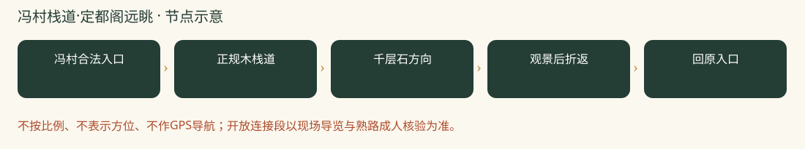

# 冯村栈道·定都阁远眺：一日攻略

> 栈道登山＋开阔山景＋远眺定都阁｜走得更像一次爬山，按时间折返，路程可控。｜排名8/8｜20261026-v2｜8-9岁孩子｜基准周末10月31日至11月1日。各城区出发，当天往返；未实地踩线或电话预订。

**特点：栈道登山＋开阔山景＋远眺定都阁。走得更像一次爬山，按时间折返，路程可控。**

## 评分

| 维度 | 0-5分 | 换算分 | 理由 |
|---|---:|---:|---|
| 秋色（25） | 3.5 | 17.5 | 山野远眺有特色，春桃花资料不能证明秋季盛红 |
| 儿童适配（25） | 2.5 | 12.5 | 正规栈道往返、按时折返可控；秋季同线强度未实测，不能保证到阁 |
| 交通（15） | 3.0 | 9.0 | 全市自驾或地铁到门头沟接驳可当日返 |
| 行程舒适（15） | 2.5 | 7.5 | 山上自给、早起，厕所和车辆混行等限制较多 |
| 人流体验（10） | 3.5 | 7.0 | 较分散，但不保证热门季少人 |
| 执行确定性（10） | 2.5 | 5.0 | 入口和短返路线需熟路成人临期确认，不能把旧长环线当当前通行证明 |

**总分58.5/100。** [统一评分说明](README.md#评分与排序)。

## 从全市各处怎么会合

**集合：**09:30 冯村正规栈道合法入口，熟路成人提前发实际定位。

**结束：**14:30-15:00 同一入口。

各家庭从西城、海淀、朝阳等实际地址分别出发，在景区入口集合，不先绕到一个市区点。出门时刻=集合时刻-本家当日路线预计耗时-停车/步行20至30分钟。各方案的分钟数只是跨城排程宽预算，不是导航实测；不能把行政区当成一个固定起点。

各城区排程宽预算：自驾75-150分钟；地铁到门头沟再接驳120-210分钟。不是实时导航；各家按09:30入口集合倒推，并另留停车步行20-30分钟，远端可能更久。

**自驾：**分别导航冯村正规栈道入口，由熟路朋友提前发实际集合定位与合法停车点。旧游记导航天主教堂附近路边停车，不能直接当合法车位保证。不要私占社区、消防通道或跟随越障进山。

**公共交通：**可先乘地铁6号线/S1线等到门头沟城区再接官方公交或网约车，确切入口确定后查两端接驳。旧资料931/981站点不可不核就当当前班次。纯公交家庭若不能赶早或回程末段未落实，选基本往返，不走完整长线。

**迟到：**出发前30分钟在家长群报预计抵达时刻；缓冲窗口内集合，超过窗口由领队决定全队等候还是安排成人陪迟到家庭在入口会合。不得让儿童独自在山路追队。

## 路线与景色

推荐正规栈道向千层石、定都阁方向行进，按时间原路往返，全天步行控制约4-6公里；这是组织控制目标，不是已测量轨迹，累计爬升未核。不以到定都阁为必达。已有到阁完整环线参考12公里、爬升600米、7小时，明显更强，不混入本次推荐。

冯村合法入口 → 正规木栈道 → 千层石方向 → 观景后折返 → 回原入口。

只安排冯村正规栈道往返和开放观景点，天气与视线允许时远眺定都阁。不执行旧12公里不老泉环线，不经过锁门绕行段，不承诺入阁。出发前由熟路成人确认合法入口与当天通行，路不通就原路返。

**打卡点**

- 冯村正规栈道与山林秋色，秋叶程度需新实拍
- 千层石方向开放观景点，可视条件下远眺定都阁
- 到达合法外侧区域才看定都阁外观；不进入修缮区、不上临崖巨石

**赏秋时机：**资料主力为2025春季实走，适合参考路线强度，不能把桃花图片换称红叶实况。2026秋季定都阁有修缮反馈，入阁不列为目标；秋色不确定性已反映在分数。

## 一天怎么安排

各时间为组织建议，不是节点实测。吃饭、拍照、休息和停车接近均算进一天；能当天往返不等于必须把所有加量段走完。

| 时间 | 安排 |
|---|---|
| 09:30-09:45 | 入口集合、厕所、核路线与封控 |
| 09:45-11:00 | 正规栈道慢走、山林观察 |
| 11:00-11:15 | 加餐、温水与休息 |
| 11:15-11:45 | 继续至已确认开放的观景段；11:45停止向上 |
| 11:45-12:30 | 允许区域自带午饭，随后原路下山 |
| 12:30-14:30 | 慢下山、拍照与休息，不接不老泉或野径 |
| 14:30-15:00 | 同一入口点名解散，各家返城；热饭可在城区自行安排 |

## 吃饭与备用午餐

11:45-12:30在允许休息处自带主食午饭，途中补水加餐。每家带饭团/三明治、熟蛋肉、水果和温水；14:30下山后可到城区吃热饭，不饿着等下午。若订餐先确认儿童不辣主食、多人座位和厕所。

## 厕所、补水与休息

入口附近先解决厕所，途中按无可靠厕所补给准备。离线地图、头灯与备用衣物必备；不把手机有信号或临时叫车当撤退条件。

## 门票、开放与预约

短栈道、村道与定都阁景区不是同一收费边界；未核准当前管理，不承诺免费或可入阁。010-61869088为历史公开咨询线索，未电话核实。取消AAA不等于官方闭园，但近期修缮要核。

## 家庭预算

一大一小自带午饭40-80元；下山可选热饭60-120元，交通停车另计；不预付未核准景区票。

## 缩短路线与撤退

11:45停止向上并沿来路返，孩子疲倦更早返；不绕锁门、不穿铁丝网。15:00回到入口为目标。这里只推荐栈道往返，不把它包装成已核准的到阁长环线。

## 给孩子的观察任务

让孩子读正规路牌，画山脊轮廓与远处建筑；完成标准是全队当日安全返回，不是一定登阁。

## 资料与仍待确认

2025两步路正文12公里600米7小时说明当天长线存在，但标签“亲子初级”不适用于所有8-9岁孩子。没有找到足够可靠的同起点7公里300米合法到阁闭环，故明确区分基本弹性往返与待核完整长线，不编造缩短轨迹。

- [2025两步路实走12公里600米7小时](https://www.2bulu.com/community/gotohuatinfo.htm?id=UQ30N68rQSzVf3tcNf0S8A%3D%3D&type=1)
- [2026区文旅局取消AAA原文](https://www.bjmtg.gov.cn/bjmtg/zwxx/zwgg/202609/d530bf90933445d2b5fda12dcd6b40e8.shtml)
- [2026定都阁方向实走相册（不同起点）](https://www.beijinghikers.com/photos-and-news/through-the-hills-to-dingdu-pavilion-and-tanzhe-temple-2026-03-07/)
- [2026近期游客修缮反馈](https://www.xiaohongshu.com/explore/6adb6887000000002a0124a1)
- [北京10月日落时间](https://www.timeanddate.com/sun/china/beijing?month=10&year=2026)

旧照片、成人轨迹、官方稳定规则和本周开放分开看。停车费、门票优惠、餐馆营业、接驳均须临期核实。未授权原图不打包，原帖可要求登录。

[返回方案总览](README.md) · [行前准备](出行准备与安全.md)
