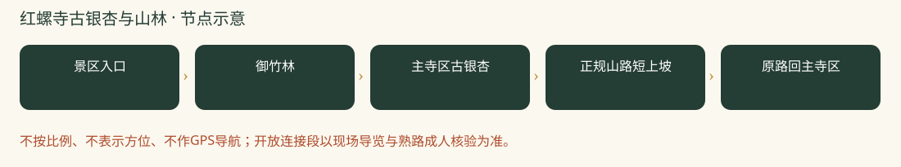

# 红螺寺古银杏与山林：一日攻略

> 银杏加登山，车程与台阶更多｜本轮排名 6｜资料整理：2026-10-26｜基准周末：10月31日至11月1日。8-9岁多孩小队，山林徒步优先。未实地踩线、未电话预订。

## 怎么选与评分

| 维度 | 0-5分 | 权重 | 换算得分 | 理由 |
|---|---:|---:|---:|---|
| 秋色 | 4.5 | 25 | 22.5 | 古银杏、寺院与山林组合鲜明，今年全黄程度未核准 |
| 儿童适配 | 3.5 | 25 | 17.5 | 可拆成寺院和短上坡，不走完整观音寺登顶 |
| 交通 | 2.0 | 15 | 6.0 | 怀柔较远，多孩小队往返成本高 |
| 行程舒适 | 3.5 | 15 | 10.5 | 午饭和山路分段安排，餐馆须提前确认 |
| 人流体验 | 3.0 | 10 | 6.0 | 银杏热点集中，清早参观更舒适 |
| 执行确定性 | 3.5 | 10 | 7.0 | 正规景区可用，最新叶色情况及短线爬升尚有缺口 |

**总分：69.5/100。** 主观规划分，不是景区评级；见[评分规则](README.md#评分规则)。

## 路线、景色与体力

基本版控制3-4公里、3-3.5小时含休息；只在主寺区后方正规山路短走。完整观音路有大量台阶，不把成人1.6万步游记当儿童基本版。

景区入口 → 御竹林 → 主寺区古银杏 → 正规山路短上坡 → 原路回主寺区。

入口确认合法山路和折返点，上坡最多约40分钟再回，短线不保证到观音寺；不登中天门、不追主峰，不靠滑道作撤退。

**打卡点**

- 大雄宝殿前雌雄古银杏与屋檐
- 御竹林的绿色与秋叶形成对比
- 正规山路开阔休息点看远山，不站崖缘拍照

**今年时机：**2025-11-05官方旅游文章记录古银杏当时已到观赏期，仅作往年窗口参考。2026近期检索标题同时有‘预告’与‘最佳’，没有足够证据保证本周全黄，出发前看园方新实拍。

## 一天怎么安排

时间为组织建议，不是实测到达时间；每段按最慢孩子调整，取消后半段也算完成。

| 时间 | 安排 |
|---|---|
| 07:30 | 市区西部出发，车上不安排补觉以外额外活动 |
| 09:15-09:45 | 停车、厕所、看当天步道图 |
| 09:45-10:45 | 御竹林与主寺区古银杏 |
| 10:45-12:00 | 正规山路短上坡后原路返，不以登顶为目标 |
| 12:00-13:00 | 午饭与休息 |
| 13:00-14:00 | 寺区慢走、树叶手帐，疲惫可直接离园 |
| 14:00-16:30 | 返城；拥堵另计 |

## 自驾与停车

市区西部约100-150分钟预算，导航红螺寺景区正规停车场，08:00出发易偏晚，建议07:30出发。午后返城另留堵车缓冲。

## 公共交通

常规公交需东直门916快接怀柔当地公交，耗时较长，不作为本次多孩团首选。通游专线节假日运行公告不等于普通周末一定开行，先在北京公交核班次。

## 午饭怎么解决

主方案自带午饭，12:00在允许休息处用餐；希望吃热饭则出发前联系景区入口正规餐馆，确认儿童不辣主食、多人座位和停车。未落实不临场全队找网红虹鳟店，更不加雁栖湖第二场。

## 厕所、补水与休息

入园与上山前先上厕所。山路不依赖摊位供热水；自带温水、纸巾、备用衣物。寺院安静慢行，不把祈福项目当儿童必做任务。

## 门票、开放与预约

北京旅游网参考成人54元、全日制大中小学生有效学生证半价。儿童免票条件为6岁及以下或不足1.2米，8-9岁不能仅按儿童称呼认定免费。010-60681175/60681639，园方官方入口核准门票与季节闭园。

## 家庭预算

若学生半价资格核准，一大一小门票约81元；餐食60-120元，加高速、油费与停车。

## 缩短路线、天气与撤退

主寺区赏树即是有效完成；有人疲倦全队取消山路。不能用成人20分钟陡阶下山数据催孩子。

## 给孩子的任务

银杏与竹子叶形有什么不同？看古树保护围栏与支撑设施，讨论怎样保护一棵老树。禁止食用银杏果。

## 资料、近期经验与未知项

近期原帖显示完整观音路、中天门行程有大量台阶和长步行，故主动裁剪。未把周中少人、成人快速下山或祈愿效果作为推荐依据。

- [门票与学生优惠（北京旅游网）](https://s.visitbeijing.com.cn/attraction/101418)
- [官方票务介绍与公开电话](https://english.beijing.gov.cn/specials/ticketing/attractions/202409/t20240930_3910069.html)
- [2025银杏观赏实况对照](https://www.visitbeijing.com.cn/article/4P0SilHTGYk)
- [2026-10-22编辑，爱拍照的鱼：1.6万步登山游记](https://www.xiaohongshu.com/explore/6ad87c6f000000003101f912)

小红书仅采用作者公开经验，里程与停车费未经独立实测；原帖可能要求登录。未复制全文或把旧照片当今年现场。图片原帖可点来源查看，未取得转载许可的不打包进仓库。

[返回总览与评分](README.md) · [天气与队伍准备](出行准备与安全.md)
