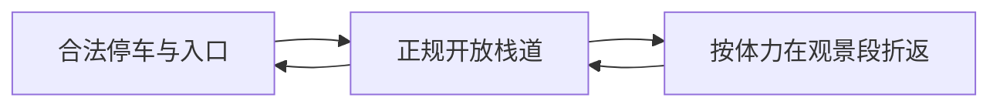

# 定都阁与冯村：分清短栈道、登阁和完整环线

2026-10-26补查，条件研究，不属于TOP 7确定行程。

## 本轮补查证据

- [区文旅局2026-09-18原文](https://www.bjmtg.gov.cn/bjmtg/zwxx/zwgg/202609/d530bf90933445d2b5fda12dcd6b40e8.shtml)：服务与游览设施未达标准，取消AAA。**不等于闭园令，也不证明仍能入阁。**
- [两步路乐天2025冯村—定都阁—不老泉](https://www.2bulu.com/community/gotohuatinfo.htm?id=UQ30N68rQSzVf3tcNf0S8A%3D%3D&type=1)：虽标亲子初级、6岁+，实走是**12公里、爬升600米、7小时**。不采用绕锁闭水库的指引；春桃花不能当秋叶实况。
- [Beijing Hikers 2026-03-07实走相册](https://www.beijinghikers.com/photos-and-news/through-the-hills-to-dingdu-pavilion-and-tanzhe-temple-2026-03-07/)确认有混合山径、公路线路，不能证明秋季全线自行带孩子适用。
- [2026-10-25编辑的小红书原帖](https://www.xiaohongshu.com/explore/6adb6887000000002a0124a1)称定都阁修缮暂不开放，广慧寺方向环线7公里/500米。游客反馈不替代主管公告，但不能再写“必进定都阁”。
- [旧景区页](https://s.visitbeijing.com.cn/attraction/119811)仍列AAA、50元与8:30-17:00，AAA已被更新公告否定，因此不照用其旧开放时间。010-61869088仅作核验线索，未拨打。

## 冯村正规栈道短返预评分

| 维度 | 0-5分 | 换算分 | 理由 |
|---|---:|---:|---|
| 秋色25 | 3.5 | 17.5 | 秋叶实况弱于春花资料 |
| 儿童25 | 2.5 | 12.5 | 短栈道可能适合，完整线强度高 |
| 交通15 | 3.5 | 10.5 | 离城近，停车接近路待核 |
| 舒适15 | 2 | 6 | 厕所补给、路面信息不足 |
| 人流10 | 3.5 | 7 | 不保证周末少人 |
| 确定性10 | 1.5 | 3 | 缺当前开放与具体短线 |
| **总分** | | **56.5** | **条件未满足，不进确定排名** |

分数针对拟裁剪短返，不是12公里成人环线。安全、合法进入不能被景色得分抵消。

## 条件落实后的改法与一天

确认开放的冯村正规栈道入口 → 正规观景段 → 原路返同一入口。不设登阁必达，不接不老泉、圈门、天坑或野径。

示意不按比例、不作导航。朋友须给同一起终点的近期轨迹、总长、爬升、破损台阶、临崖点和撤返。没有轨迹不编公里数。

| 时间 | 安排 |
|---|---|
| 08:30-09:30 | 市区西部出发，自驾45-75分钟仅为预算 |
| 09:30-10:00 | 合法停车、厕所、核路线与封控 |
| 10:00-11:30 | 正规栈道短走，最晚11:30开始原路返 |
| 12:30-13:30 | 回门头沟城区正规餐馆午饭，预先确认座位 |
| 13:30-14:00 | 允许区域休息、自然笔记 |
| 14:00-16:00 | 返程，按实时交通调整 |

**吃饭：**先问儿童不辣主食、多人座位与厕所；备一份可直接吃的午饭，不饿着找网红店。山路不依赖热水商店。

**交通票务：**入口未确定前不编精确公交线路，不靠山路临时叫车。停车服从管理；是否收费、能否入阁未核，不承诺免费。餐食一大一小60-120元为预算，交通停车另计。

**天气与取舍：**雨后、大风或封段取消山路，不绕门；更建议本次选北宫、百望山或千灵山。想要古银杏兼山林，继续核广慧寺短返。等具体短线与合法开放落实，再重新评分。

[返回总览](README.md) · [广慧寺专项](09-广慧寺短线研究.md)
