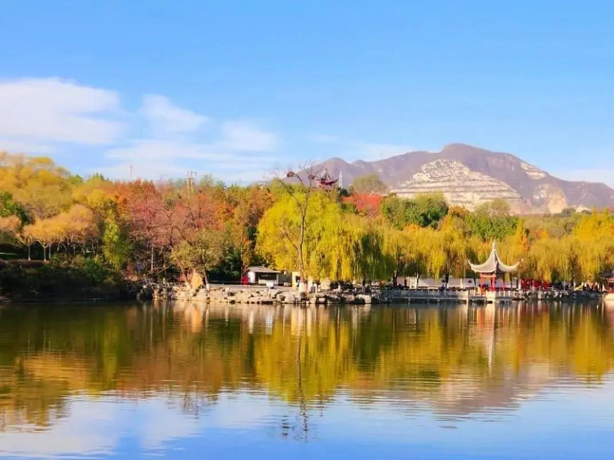
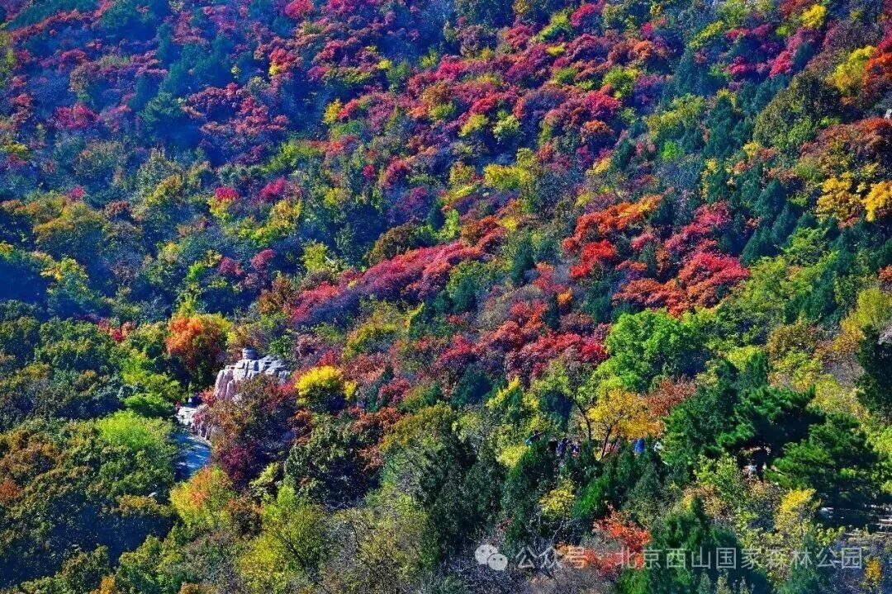
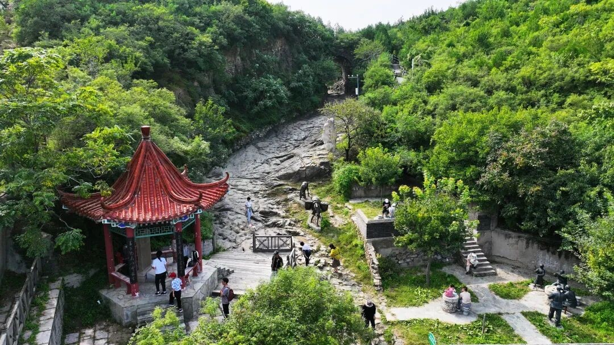
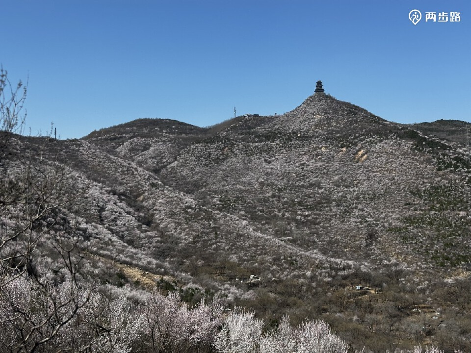

# 北京赏红叶与银杏｜8条亲子一日路线

> 20261026-v4 · 8-9岁 · 西城、海淀、朝阳等分别出发 · 当天往返

想轻松组队、地铁会合，先看百望山；想兼顾湖景彩林与爬山，看北宫；专注红叶看西山；愿意用完整一天走古道加古银杏，看广慧寺。冯村需熟路领队先核入口和通行。

## 评分与排序

六项0-5分，按秋色25、儿童适配25、交通15、时间舒适15、人流10、执行确定性10换算，总计100分。分数为规划比较，3分以内差距不宜过度解读。入口与合法通行是成行前提，不能用景色得分抵消。

| 排名 | 方案 | 秋色25 | 儿童25 | 交通15 | 舒适15 | 人流10 | 确定性10 | 总分 | 核心特点 |
|---|---|---:|---:|---:|---:|---:|---:|---:|---|
| 1 | [百望山森林公园](01-百望山亲子登高.md) | 17.5 | 22.5 | 13.5 | 13.5 | 7.0 | 9.0 | **83.0** | 地铁方便＋亲子山路＋古树彩叶 |
| 2 | [北宫国家森林公园](02-北宫山林赏秋.md) | 22.5 | 22.5 | 9.0 | 13.5 | 7.0 | 8.0 | **82.5** | 彩林＋湖景＋轻登山 |
| 3 | [西山国家森林公园](03-西山低位赏红.md) | 22.5 | 20.0 | 10.5 | 10.5 | 6.0 | 9.0 | **78.5** | 红叶山林＋近城徒步 |
| 4 | [广慧寺·两寺一阁](04-广慧寺两寺一阁.md) | 22.5 | 20.0 | 9.0 | 9.0 | 8.0 | 7.0 | **75.5** | 古道＋两寺银杏＋定都阁远眺 |
| 5 | [红螺寺古银杏与山林](05-红螺寺山林银杏.md) | 22.5 | 17.5 | 6.0 | 10.5 | 6.0 | 7.0 | **69.5** | 古银杏＋竹林＋寺后山林 |
| 6 | [水峪嘴京西古道](06-京西古道短线.md) | 15.0 | 20.0 | 7.5 | 10.5 | 8.0 | 8.0 | **69.0** | 马蹄窝＋关城＋古道探秘 |
| 7 | [潭柘寺古银杏慢游](07-潭柘寺银杏.md) | 20.0 | 15.0 | 6.0 | 12.0 | 5.0 | 8.0 | **66.0** | 古银杏＋红墙＋千年古建 |
| 8 | [冯村栈道·定都阁远眺](08-冯村栈道定都阁远眺.md) | 17.5 | 12.5 | 9.0 | 7.5 | 7.0 | 5.0 | **58.5** | 栈道登山＋开阔山景＋远眺定都阁 |

## 看图选路线

### 1. [百望山森林公园](01-百望山亲子登高.md) · 83.0分

**地铁方便＋亲子山路＋古树彩叶**

各城区容易会合，沿官方亲子游线看彩林与碑林。

2026文章资料图，拍摄日期未标注；非本周叶色保证。[北京旅游网综合](https://www.visitbeijing.com.cn/article/4TgYO5RfscG)。署名：北京旅游网综合；逐图署名见原文及素材说明。

**一天安排**：09:45 东门集合；地铁家庭可09:15马连洼站A口会合；12:30午饭；14:30-15:00结束。

**步行**：采用2025官方导览图的青绿色家庭亲子线，沿已开放路段分段往返；当天步行控制约3-4公里，含观察休息约3小时。马连洼站到东门的往返接近步行另计。

### 2. [北宫国家森林公园](02-北宫山林赏秋.md) · 82.5分

**彩林＋湖景＋轻登山**

颜色丰富、景观变化多，适合一群孩子边爬边玩。

2024往年秋色资料，不代表今年实况。[北京旅游网综合](https://www.visitbeijing.com.cn/article/4KAXPmGpueo)。署名：北京旅游网综合；逐图署名见原文及素材说明。

**一天安排**：09:30-10:00 南门检票入口外集合；不是停车场入口；12:30午饭；14:30-15:00结束。

**步行**：南门—小江南—行龙谷低位开放段往返，当天步行控制3-4公里，含休息约3小时；停车和公交接近步行另计。

### 3. [西山国家森林公园](03-西山低位赏红.md) · 78.5分

**红叶山林＋近城徒步**

想把重点放在看红叶、走山林，选这一条。

2026文章资料图，拍摄日期未标注；非本周叶色保证。[北京旅游网综合](https://www.visitbeijing.com.cn/article/4TgYO5RfscG)。署名：北京旅游网综合；逐图署名见原文及素材说明。

**一天安排**：09:30-10:00 东门检票入口外集合；12:20午饭；14:30-15:00结束。

**步行**：控制3-4公里、约3小时含观察休息；到哪折返由现场路牌、时间与最慢孩子决定，不声称这是已测量闭环。

### 4. [广慧寺·两寺一阁](04-广慧寺两寺一阁.md) · 75.5分

**古道＋两寺银杏＋定都阁远眺**

一整天把山林与古建串起来，最接近你认可的徒步思路。

2026文章资料图，拍摄日期未标注；非本周叶色保证。[北京旅游网综合](https://www.visitbeijing.com.cn/article/4TeunGHpU29)。署名：北京旅游网综合；逐图署名见原文及素材说明。

**一天安排**：09:00 桑峪村观山小筑附近事先确认的合法步道入口；12:00午饭；15:45-16:00 潭柘寺正式出口结束。

**步行**：2025年11月实走帖记录的路线约7公里、爬升300米；孩子队山林徒步预留4.5-5小时含休息和路餐，寺内参观另留约1小时。2026另有同名7公里500米版本，出发前须让熟路成人确认采用的同一条轨迹；不将两条路线拼接。

### 5. [红螺寺古银杏与山林](05-红螺寺山林银杏.md) · 69.5分

**古银杏＋竹林＋寺后山林**

一处兼看古树和爬山，景色丰富但车程较长。

2025往年秋色资料，不代表今年实况。[北京旅游网](https://www.visitbeijing.com.cn/article/4P0SilHTGYk)。署名：北京旅游网；逐图署名见原文及素材说明。

**一天安排**：09:30-10:00 红螺寺正式入口外集合；12:30午饭；15:00-15:30结束。

**步行**：本次线路控制3-4公里、3-3.5小时含休息；只在主寺区后方正规山路短走。完整观音路有大量台阶，不把成人1.6万步游记当儿童本次线路。

### 6. [水峪嘴京西古道](06-京西古道短线.md) · 69.0分

**马蹄窝＋关城＋古道探秘**

孩子一路有东西找、有故事听，适合边走边探索。

景观资料，非当季叶色；不能把文中冬夏配图当本周实况。[北京旅游网](https://www.visitbeijing.com.cn/article/4QLxdKsMG2m)。署名：北京旅游网；逐图署名见原文及素材说明。

**一天安排**：09:45-10:00 水峪嘴景区正式入口外集合；12:30午饭；14:30-15:00结束。

**步行**：2025市文旅局介绍景区徒步约2.1公里、1.5-2小时；是否包括停车接近路和具体起终点须现场问清。孩子队预留2.5小时，总步行控制3-4公里，不延伸成人环线。

### 7. [潭柘寺古银杏慢游](07-潭柘寺银杏.md) · 66.0分

**古银杏＋红墙＋千年古建**

最适合专门看银杏、拍照和慢慢逛，运动量较少。

2025往年秋色资料，不代表今年实况。[北京旅游网](https://www.visitbeijing.com.cn/article/4P0SilHTGYk)。署名：北京旅游网潭柘寺段标注小红书@阿茉aMore；依原文署名保留。

**一天安排**：09:45-10:00 潭柘寺正式入口外集合；12:30午饭；14:30-15:00结束。

**步行**：寺内控制2-3公里、2.5-3小时，循正规参观路慢慢上阶。它是山地寺院慢游，不包装成爬山环线。

### 8. [冯村栈道·定都阁远眺](08-冯村栈道定都阁远眺.md) · 58.5分

**栈道登山＋开阔山景＋远眺定都阁**

走得更像一次爬山，按时间折返，路程可控。

2025春季桃花/地形资料，不能当秋色；不复制旧长环线与锁门绕行做法。[两步路·乐天（HikerTan）亲子实走游记](https://www.2bulu.com/community/gotohuatinfo.htm?id=UQ30N68rQSzVf3tcNf0S8A%3D%3D&type=1)。署名：乐天（HikerTan）/北京小野户外，保留两步路水印；公开原帖不等于取得转载授权。

**一天安排**：09:30 冯村正规栈道合法入口，熟路成人提前发实际定位；11:45午饭；14:30-15:00 同一入口结束。

**步行**：从熟路领队确认的冯村正规入口沿木栈道往返，11:45停止向上。总步行以约4-6公里为控制目标，不保证到千层石；2024同线资料显示千层石距起点约3.05公里，到那里往返已约6.1公里，另加停车接近路。

## 集合与交通

各家庭从西城、海淀、朝阳等实际地址分别出发，在约定的景区入口集合。先查本家当天导航，再倒推出门时刻；另留停车、进出站和步行20-30分钟。下列交通范围仅为排程宽预算，不是各行政区固定车程。

| 方案 | 集合 | 结束 | 成行前提 |
|---|---|---|---|
| 百望山森林公园 | 09:45 东门集合；地铁家庭可09:15马连洼站A口会合 | 14:30-15:00 | 按景区当日开放游线执行 |
| 北宫国家森林公园 | 09:30-10:00 南门检票入口外集合；不是停车场入口 | 14:30-15:00 | 按景区当日开放游线执行 |
| 西山国家森林公园 | 09:30-10:00 东门检票入口外集合 | 14:30-15:00 | 按景区当日开放游线执行 |
| 广慧寺·两寺一阁 | 09:00 桑峪村观山小筑附近事先确认的合法步道入口 | 15:45-16:00 潭柘寺正式出口 | 熟路领队先核同一轨迹、准确入口与当日通行 |
| 红螺寺古银杏与山林 | 09:30-10:00 红螺寺正式入口外集合 | 15:00-15:30 | 按景区当日开放游线执行 |
| 水峪嘴京西古道 | 09:45-10:00 水峪嘴景区正式入口外集合 | 14:30-15:00 | 按景区当日开放游线执行 |
| 潭柘寺古银杏慢游 | 09:45-10:00 潭柘寺正式入口外集合 | 14:30-15:00 | 按景区当日开放游线执行 |
| 冯村栈道·定都阁远眺 | 09:30 冯村正规栈道合法入口，熟路成人提前发实际定位 | 14:30-15:00 同一入口 | 需熟路领队确认入口与通行后成行 |

## 地图与资料怎么读

六处使用实际景区导览图或导览牌实拍；广慧寺和冯村采用有来源的地区地图，标明步行段、车行衔接与核验边界。不要把完整景区长环线、成人用时或山峰海拔当作本次儿童队实测。各页注明图源和拍摄时段，不把旧图当实时秋色。

## 唯一分享文件

[下载最新完整PDF](../../output/pdf/北京赏红叶与银杏_亲子图文攻略_20261026.pdf)：首页评分总表，每条路线包含照片、地图与主要攻略。旧长图不再保留。

[出行准备](出行准备与安全.md) · [素材署名](assets/README.md)
